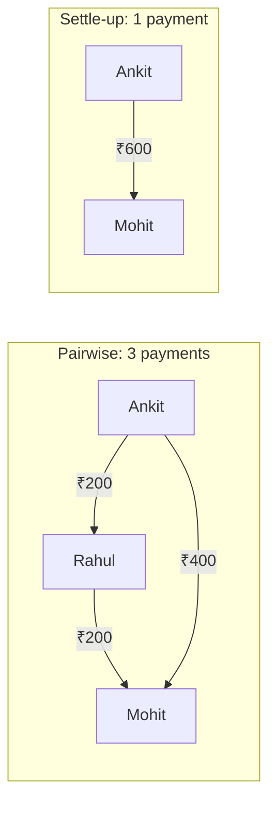
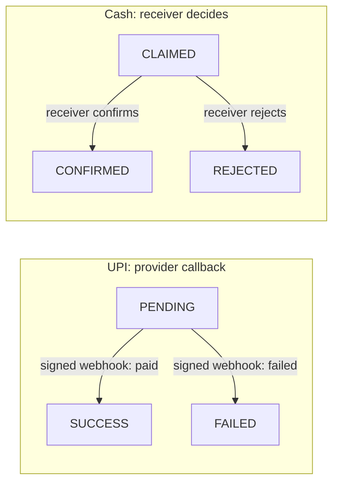

# Akira: Splitting Expenses Without Losing Trust


A backend for groups who share expenses: who paid, who owes, and who should pay whom. Built with **FastAPI**, **PostgreSQL 16**, **SQLAlchemy 2.0** and **Alembic** .

The brief asks for users, groups, expenses and balances. All of that is here. Most of the work went into the part the brief left open: **making the numbers trustworthy** : exact money, no duplicates, no overpayment, no one reading someone else's group, and proof if history is changed.

| | |
|---|---|
|  **Demo video** | [Watch walkthrough (2 min)](https://github.com/user-attachments/assets/4aaf246b-7e02-4f79-b101-af04b22fa543) |
|  **Live API** | https://akira-expense-sharing.onrender.com |
|  **Interactive docs (Swagger)** | https://akira-expense-sharing.onrender.com/docs |
|  **User profile endpoint** | https://akira-expense-sharing.onrender.com/docs#/users/get_current_user_users_me_get |
|  **Health check** | https://akira-expense-sharing.onrender.com/health |

> The live service runs on a free tier. If it has been idle, the first request takes about a minute while it wakes up. Payments use a **mock provider** (every response carries `X-Environment: demo-mock-payments`).

---

## Contents

- [At a glance](#at-a-glance)
- [The Goa trip example](#the-example-used-everywhere-a-goa-trip)
- [Verified walkthrough (16 live scenarios)](#verified-walkthrough-live-via-swagger)
- [Run it locally](#run-it-locally)
- [How it works](#how-it-works)
  - [Arithmetic correctness](#how-it-works)
  - [Protection and authentication](#how-it-works)
  - [Audit hash chain](#how-it-works)
  - [Differences from the brief](#how-it-works)
  - [Code layout and database roles](#how-it-works)
  - [Deployment (Render + Neon)](#how-it-works)
- [PostgreSQL test suite](#tests)
- [Known limits](#known-limits)
- [What I would do next](#what-i-would-do-next)

---

## At a glance

- **Exact money.** Amounts are integer paise. ₹1,000 ÷ 3 = ₹333.34 + ₹333.33 + ₹333.33, never ₹999.99.
- **History that doesn't shift.** Each expense stores who shared it at that moment, so a late joiner never inherits old bills.
- **No duplicates, no overpayment.** Idempotency keys stop double taps; a row lock per group stops two payments racing each other.
- **Smart settle-up (product enhancement).** Turns many pairwise debts into the fewest payments.
- **Only members see a group.** Bearer tokens (stored hashed) and a membership check on every group route; outsiders get `404`.
- **"I paid" isn't enough.** UPI settlements complete only on a signed provider callback; cash needs the receiver to confirm.
- **Private UPI IDs.** Encrypted with AES-256-GCM, shown masked (`mo***@okhdfcbank`).
- **Tamper-evident.** Every money event is HMAC hash-chained; `audit/verify` reports any change. The app's DB role cannot `UPDATE` or `DELETE` history.
- **Tested on real Postgres.** 193 tests, 93% coverage, including parallel-write tests on separate connections.

---

## The example used everywhere: a Goa trip

Mohit pays ₹1,200 for dinner. Rahul pays ₹600 for a cab. Ankit pays nothing.

```text
Pairwise:  Rahul owes Mohit ₹200 · Ankit owes Mohit ₹400 · Ankit owes Rahul ₹200   (3 payments)
Net:       Mohit +₹600 · Rahul ₹0 · Ankit −₹600                                    (sums to ₹0)
Settle-up: Ankit pays Mohit ₹600                                                    (1 payment)
```



---

## Verified walkthrough (live, via Swagger)

Every scenario below was run against the live deployment. Run them yourself at [`/docs`](https://akira-expense-sharing.onrender.com/docs):

1. Create users with `POST /users` (one request per user). Save each user's `id` and `api_token` (the token is shown only once).
2. Click **Authorize** and paste a user's token (without the word "Bearer") to act as that user.
3. Use a **new `Idempotency-Key`** for every new write, unless the step says to repeat one.

| # | Scenario | Act as | Steps | Result | Screenshot |
|---|---|---|---|---|---|
| 1 | One-time token | None | `POST /users`, then `GET /users/me` | Token appears at signup only; `/users/me` has none | [](assets/screenshots/test-1.jpg) |
| 2 | Token required | None | Any authenticated route without a token | `401 UNAUTHENTICATED`, consistent error body, security headers present | [](assets/screenshots/test-2.jpg) |
| 3 | Group and members | Mohit | Create "Goa Trip", add Rahul and Ankit, add Rahul again | `201`, `201`, then `409 ALREADY_MEMBER` | [](assets/screenshots/test3-1.jpg) [](assets/screenshots/test3-2.jpg) |
| 4 | Idempotent expense | Mohit | Dinner ₹1200 `EQUAL` with key `dinner-1`; repeat; repeat with ₹1300 | Same expense id twice; then `422 IDEMPOTENCY_KEY_REUSED` | [](assets/screenshots/test4.jpg) |
| 5 | Input validation | Mohit | Amount `"0"`, `"10.001"`, or an unknown field | `422` each time | [](assets/screenshots/test5-1.jpg) [](assets/screenshots/test5-2.jpg) [](assets/screenshots/test5-3.jpg) |
| 6 | Paise rounding | Mohit | New group of 3, ₹1000 `EQUAL` | Shares 333.34 / 333.33 / 333.33 | [](assets/screenshots/test6.jpg) |
| 7 | Any member can record | Rahul | Cab ₹600 in Goa Trip | `201` | [](assets/screenshots/test7.jpg) |
| 8 | Balances | Mohit | `GET /groups/{id}/balances` | Pairwise debts as in the example; net sums to 0 | [](assets/screenshots/test8.jpg) |
| 9 | Settle-up | Mohit | `GET /groups/{id}/settle-up` | One transfer: Ankit -> Mohit ₹600 | [](assets/screenshots/test9.jpg) |
| 10 | Outsider blocked | Zara (not a member) | Goa Trip balances | `404`, not `403`: the group's existence isn't revealed | [](assets/screenshots/test10.jpg) |
| 11 | Encrypted UPI ID | Mohit, then Rahul | `PUT /users/me/vpa`; Rahul tries the same VPA | Masked `mo***@okhdfcbank`; Rahul gets `409` | [](assets/screenshots/upi-lifecycle-test11.jpg) |
| 12 | Overpayment blocked | Ankit | Settle ₹700 against a ₹600 debt | `422 OVERPAYMENT` | [](assets/screenshots/upi-lifecycle-test12-1.jpg) [](assets/screenshots/test-12b.jpg) |
| 13 | UPI lifecycle | Ankit | Settle ₹600 by UPI -> `PENDING`; trigger `POST /dev/mock-provider/pay/{reference}` with `outcome=success`; trigger it again | `SUCCESS` once; the repeat changes nothing; balances clear | [](assets/screenshots/upi-lifecycle-test-combined.jpg) [](assets/screenshots/test-ignored.jpg) [](assets/screenshots/test-ankit_ka_loan_khatam.jpg) |
| 14 | Cash needs confirmation | Ankit, then Mohit | Cash settlement -> `CLAIMED`; check balances; Mohit confirms | Balance unchanged until `CONFIRMED` | [](assets/screenshots/upi-lifecycle-test14.jpg) [](assets/screenshots/upi-lifecycle-test14-2.jpg) |
| 15 | Notifications | Mohit | `GET /users/me/notifications` | Expense and settlement events, written in the same transaction | [](assets/screenshots/test13-notification.jpg) |
| 16 | Audit chain | Mohit | `GET /groups/{id}/audit/verify` | `valid: true` | [](assets/screenshots/test-15-audit.jpg) |

Rate limiting (`429` + `Retry-After`) and the database-role and tamper tests are covered by the automated suite (see [Tests](#tests)).

---

## Run it locally

```bash
git clone https://github.com/AdityaP700/Akira.git && cd Akira
cp .env.example .env          # fill LOCAL_DB_PASSWORD and the keys (comments explain each)
python -c "import secrets; print(secrets.token_hex(32))"   # generate a key; one per variable
docker compose up --build
```

API on `http://localhost:8000`, docs on `/docs`. Seed the Goa trip with `python scripts/seed_goa_trip.py`. A Postman collection is in `postman/expense-sharing.postman_collection.json` (set `base_url` to local or live).

---

## How it works

<details>
<summary><b>Correct: getting the arithmetic right</b></summary>

| Concern | How Akira solves it | Impact / Guarantee |
|---|---|---|
| **Float errors** | Integer paise throughout (`int`); AST checks ban floats | Zero rounding drift; exact rupee strings at API edge only |
| **Odd division** | Deterministic 1-paisa distribution by user order | ₹1,000 ÷ 3 = ₹333.34 + ₹333.33 + ₹333.33 (never ₹999.99) |
| **Late joiners** | Frozen `expense_shares` captured at creation time | Past expenses never change when group membership updates |
| **Balance drift** | Balances computed on-the-fly from history (no balance table) | Conservation of money: net balances always sum to zero |
| **Concurrent writes** | `SELECT … FROM groups WHERE id = :id FOR UPDATE` | One writer per group; different groups execute in parallel |
| **Network retries** | `Idempotency-Key` header with cached response | Retried requests return identical response without duplicate side-effects |
| **Debt resolution** | Greedy settle-up algorithm (largest debtor to creditor) | Minimizes transfer count (at most n - 1 payments) |

</details>

<details>
<summary><b>Protected: keeping the wrong people out</b></summary>

| Layer | Defense mechanism | Guarantee |
|---|---|---|
| **Authentication** | SHA-256 hashed bearer tokens, constant-time compare | One-time token issue at signup; rotatable via `/users/me/token/rotate` |
| **Object authorization** | Group membership guard on every group route | Non-members receive `404 NOT_FOUND` (defends against BOLA probing) |
| **Input hardening** | 64 KB body cap (`413`), strict JSON (`415`), forbidden extra fields (`422`) | Defends against memory exhaustion, schema bypass, and prototype pollution |
| **Abuse / Rate limit** | Sliding-window limiter with right-walked `X-Forwarded-For` | Spoofed client headers ignored; trusted proxy hop enforcement (`429`) |
| **PII Privacy** | AES-256-GCM encryption with HMAC-SHA256 blind index | UPI VPAs stored ciphertext; exact search without decryption; masked in output |



> **Lifecycle note:** Only `SUCCESS` and `CONFIRMED` settlements alter balances. Webhook callbacks require valid HMAC-SHA256 signatures, unique event IDs, and a 300-second timestamp window to prevent replay attacks.

</details>

<details>
<summary><b>Provable: detecting changes to history</b></summary>

| Audit layer | Implementation | Guarantee |
|---|---|---|
| **Least-privilege role** | Runtime connects as `app_rw` | Zero `UPDATE` or `DELETE` grants on ledger, shares, or webhook events |
| **HMAC hash chain** | `hash_n = HMAC(key, hash_{n-1} ‖ entry_n)` | Tampering with any row breaks verification (`GET /groups/{id}/audit/verify`) |
| **Key separation** | HMAC key stored in external environment | Compromised DB dump cannot forge valid signature hashes |

</details>

<details>
<summary><b>Where Akira differs from the brief, and why</b></summary>

| Brief | Akira | Why |
|---|---|---|
| Integer ids (`"id": 1`) | Opaque ids (`usr_…`, `grp_…`) | Sequential ids can be guessed and enumerated |
| No authentication | Bearer token on group routes | Otherwise anyone can read or change any group's debts |
| `GET /users` lists everyone | Only users who share a group with you | Avoids exposing a full user directory |
| Add member with `group_id` in body | `POST /groups/{id}/members` | Resource in the path; one less mismatch case |
| `POST /expenses` | Kept, plus `POST /groups/{id}/expenses` | Nested route makes the membership check uniform |
| Name-keyed balances | Name-keyed (as in the brief) plus id-keyed net | Names can collide; ids can't |

</details>

<details>
<summary><b>Code layout and database</b></summary>

```text
app/
├── api/           routers and request/response schemas
├── services/      use cases; each owns one transaction
├── domain/        pure money logic: splits, balances, settle-up, settlement states
├── repositories/  SQL access (never commits on its own)
├── adapters/      payment provider, key provider, notifier (swappable)
├── security/      tokens, membership guard, rate limits, encryption, signatures
└── core/          config, errors, logging, public ids
```

| Table | Holds | `app_rw` can |
|---|---|---|
| `users`, `user_pii` | Users, token hashes, encrypted UPI ids | read, insert, update |
| `groups`, `group_members` | Groups (lock target) and membership | read, insert, update |
| `expenses` | Amounts in paise, split type | read, insert, update |
| `expense_shares` | Frozen per-person shares | **read, insert only** |
| `settlements` | Repayments and their status | read, insert, update |
| `ledger_entries` | Hash-chained audit log | **read, insert only** |
| `provider_events` | Webhook dedupe log | **read, insert only** |
| `idempotency_keys`, `notifications` | Replay cache, in-app notifications | read, insert, update |

More detail: [`docs/API.md`](docs/API.md), [`docs/SCHEMA.md`](docs/SCHEMA.md), [`docs/SECURITY.md`](docs/SECURITY.md).

</details>

<details>
<summary><b>Deployment (Render + Neon)</b></summary>

- **App:** Docker web service on Render (`render.yaml`), Singapore region. `scripts/start.sh` runs migrations, then the API with one worker.
- **Database:** Neon PostgreSQL 16 over TLS, with two roles created by `scripts/init_db_roles.sql` (passwords passed as `psql` variables, never stored in the repo).
- **Secrets:** set only in the Render dashboard. Every key has an id so it can be rotated.

| Variable | Purpose |
|---|---|
| `DATABASE_URL` | Runtime connection as `app_rw` |
| `MIGRATION_DATABASE_URL` | Migrations as `app_owner` |
| `APP_ENV` | `demo` (docs + mock payments) or `prod` |
| `WEBHOOK_HMAC_KEY`, `AUDIT_HMAC_KEY`, `PII_ENC_KEY`, `PII_BLIND_INDEX_KEY` | 32-byte hex keys |
| `WEBHOOK_KEY_ID`, `AUDIT_KEY_ID`, `PII_KEY_ID` | Key ids for rotation |
| `TRUSTED_PROXY_HOPS` | Proxy hops to skip when reading the client IP |

</details>

---

## Tests

193 tests run against **PostgreSQL 16** (no SQLite). Domain money logic has 100% coverage; overall 93%.

| Proven on Postgres | Result |
|---|---|
| 20 parallel expenses in one group | Ledger sequence 1..20, valid hash chain, net sums to 0 |
| 10 parallel settlements against one ₹50 debt | Exactly 1 succeeds, 9 get `422 OVERPAYMENT` |
| Parallel requests with one idempotency key | One record; every caller gets the same response |
| `UPDATE` / `DELETE` on history as `app_rw` | `permission denied` from PostgreSQL |
| Edited ledger row | `audit/verify` returns `valid: false` with the broken entry |
| Database down | `/health` and writes return `503`; no partial writes |

```bash
make test   # pytest with coverage against TEST_DATABASE_URL
make lint   # ruff + mypy
```

---

## Known limits

- Keys live in environment variables; a compromised app host could read them (next step: a KMS).
- `audit/verify` runs on request, not on a schedule.
- Amounts are stored in plaintext so the database can enforce `CHECK` constraints and sum balances.
- Rate limits are per process; multiple replicas would need a shared store.
- The payment provider is a mock with real signing and state handling.

## What I would do next

- Double-entry postings so the database itself enforces that money is conserved.
- Scheduled audit checks, with the daily chain head stored outside the system.
- KMS-managed, per-user encryption keys (deleting a key makes that user's data unreadable).
- PostgreSQL Row-Level Security so group isolation is also enforced by the database.

---

Change history: [`CHANGELOG.md`](CHANGELOG.md) · Reviewer notes: [`REVIEW_NOTES.md`](REVIEW_NOTES.md)