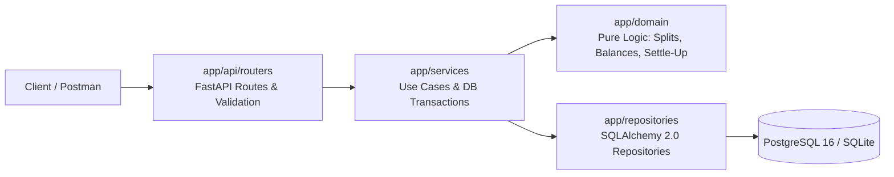

# Akira — Expense Sharing Service

A robust, production-grade backend service for groups to track shared expenses, calculate net balances, and settle balances cleanly. Built with FastAPI, SQLAlchemy 2.0, PostgreSQL 16, and Alembic migrations.

Money is strictly stored as integer paise everywhere internally, every expense stores an immutable snapshot of who shares it, and balances are derived dynamically from history so that net balances strictly sum to zero with zero balance drift.

> **Decentro SDE Intern Assignment.** Baseline release (v1) meeting all assignment specifications, structured for advanced security, payment lifecycle, and tamper-evident ledger extensions.

---

## 1. Quick Start

### Running with Docker (Recommended)

```bash
git clone <repo-url> && cd Akira
docker compose up --build
```
- API server: `http://localhost:8000`
- Interactive OpenAPI docs: `http://localhost:8000/docs`
- Health check: `http://localhost:8000/health`

### Running Locally

Prerequisites: Python 3.12+ (or 3.13) and SQLite or PostgreSQL.

```bash
# 1. Create and activate virtual environment
python -m venv .venv
source .venv/bin/activate        # On Windows: .venv\Scripts\activate

# 2. Install dependencies
pip install -e .

# 3. Apply database migrations
alembic upgrade head

# 4. Start the development server
uvicorn app.main:app --reload

# 5. Run tests & coverage
pytest -q --cov=app

# 6. Seed the Goa Trip dataset
python scripts/seed_goa_trip.py
```

---

## 2. Architecture



### Architectural Principles
1. **Pure Domain Logic (`app/domain/`):** Contains zero I/O, zero network, and zero database dependencies. All functions are pure, deterministic, and testable without mocks.
2. **Transactional Services (`app/services/`):** Each write use-case opens exactly one transaction (`with session.begin():`). Repositories never commit.
3. **Pessimistic Concurrency (`SELECT ... FOR UPDATE`):** Every mutation to a group (recording expenses or settlements) first acquires an exclusive row lock on the group row to eliminate race conditions and balance discrepancies.
4. **Integer Paise Everywhere:** Currency amounts are handled as integer paise internally. String conversions (`"1200.00"`) happen exclusively at the API boundary. Floating point values are strictly forbidden in money calculation paths.
5. **Opaque Public Identifiers:** External resources use prefixed opaque IDs (`usr_...`, `grp_...`, `exp_...`, `stl_...`). Database surrogate bigint keys never leak to external clients.

### Codebase Layout
```text
app/
  main.py                 # FastAPI application factory, middleware, router registration
  core/
    config.py             # Settings (pydantic-settings)
    db.py                 # Engine & SessionLocal factory
    errors.py             # AppError hierarchy & global exception handlers
    logging.py            # Structured logging, request_id, PII masking
    ids.py                # Public ID generation (prefix + random hex)
    pagination.py         # Keyset cursor pagination (URL-safe base64)
  api/
    deps.py               # Dependency injection (get_db, get_actor)
    routers/              # users, groups, expenses, balances, settlements, health
    schemas/              # Pydantic v2 request/response schemas (extra="forbid")
  services/               # Transactional use cases (users, groups, expenses, balances, settlements)
  domain/                 # Pure domain algorithms (money, splits, balances, settle, settlement_state)
  repositories/           # Database access layer & models.py (SQLAlchemy 2.0 Mapped[])
alembic/                  # Database migration scripts
tests/
  unit/                   # Pure domain and database constraint tests (no network)
  api/                    # HTTP endpoint integration tests (100% route coverage)
scripts/
  seed_goa_trip.py        # Idempotent seed script creating the Goa Trip dataset
postman/
  expense-sharing.postman_collection.json  # Complete sequential Postman collection
```

---

## 3. Database Design

```text
users(id BIGSERIAL PK, public_id TEXT UNIQUE, name TEXT NOT NULL, created_at TIMESTAMPTZ)
groups(id BIGSERIAL PK, public_id TEXT UNIQUE, name TEXT NOT NULL, ledger_head_seq INT, created_at TIMESTAMPTZ)
group_members(group_id BIGINT, user_id BIGINT, joined_at TIMESTAMPTZ, PRIMARY KEY (group_id, user_id))
expenses(id BIGSERIAL PK, public_id TEXT UNIQUE, group_id BIGINT, paid_by BIGINT, amount_paise INT,
         description TEXT, split_type TEXT, created_at TIMESTAMPTZ)
expense_shares(expense_id BIGINT, user_id BIGINT, owed_paise INT, PRIMARY KEY (expense_id, user_id))
settlements(id BIGSERIAL PK, public_id TEXT UNIQUE, group_id BIGINT, from_user BIGINT, to_user BIGINT,
            amount_paise INT, status TEXT, method TEXT, notes TEXT, created_at TIMESTAMPTZ)
ledger_entries(id BIGSERIAL PK, group_id BIGINT, seq INT, entry_type TEXT, entry_id BIGINT,
               payload JSONB, created_at TIMESTAMPTZ, UNIQUE (group_id, seq))
idempotency_keys(key TEXT, scope TEXT, request_hash TEXT, response_code INT, response_body JSONB,
                 created_at TIMESTAMPTZ, PRIMARY KEY (scope, key))
```

### Why this design?
- **Expense Shares Snapshot:** An expense snapshots exactly who shared the expense and how much they owed at creation time. Adding members later never alters historical splits.
- **Derived Balances (No Stored Drift):** Balances are computed dynamically from `expenses`, `expense_shares`, and confirmed `settlements`. There is no balance table that could fall out of sync with history.
- **Append-Only Ledger:** Every mutation writes an immutable, sequential record into `ledger_entries`, establishing a tamper-evident audit trail.
- **Idempotency Keys Table:** Protects mutating `POST` endpoints against duplicate requests from network timeouts and client retries.

---

## 4. REST API Overview

All error responses return a uniform envelope with the trace ID:
```json
{
  "error": {
    "code": "PAYER_NOT_MEMBER",
    "message": "Payer is not a member of the group",
    "request_id": "req_019012345678"
  }
}
```

### Endpoint Summary

| Method | Path | Request Body | Description |
|---|---|---|---|
| `GET` | `/health` | None | Health probe checking DB connectivity |
| `POST` | `/users` | `{"name": "Mohit"}` | Create a new user |
| `GET` | `/users` | None (`?limit=&cursor=`) | Keyset-paginated list of users |
| `POST` | `/groups` | `{"name": "Goa Trip"}` | Create a new group |
| `POST` | `/groups/{id}/members` | `{"user_id": "usr_..."}` | Add member to group (409 if already member) |
| `GET` | `/groups/{id}/members` | None | List members in group with `joined_at` |
| `POST` | `/groups/{id}/expenses` | `{"paid_by", "amount", "description", "split_type"}` | Record expense with shares snapshot & ledger |
| `POST` | `/expenses` | `{"group_id", ...}` | Assignment brief alias for expense creation |
| `GET` | `/groups/{id}/expenses` | None (`?limit=&cursor=`) | Keyset-paginated expense history |
| `GET` | `/groups/{id}/balances` | None | Derived pairwise debts and net balances |
| `GET` | `/balances` | None | Balances across all groups (brief alias) |
| `GET` | `/groups/{id}/settle-up` | None | Greedy debt simplification suggestions |
| `POST` | `/groups/{id}/settlements` | `{"from_user", "to_user", "amount", "method": "UPI|CASH|OTHER"}` | Initiate settlement (UPI generates intent link; CASH creates claim) |
| `POST` | `/groups/{id}/settlements/{id}/confirm` | None | Receiver confirms manual cash claim (`CLAIMED` -> `CONFIRMED`) |
| `POST` | `/groups/{id}/settlements/{id}/reject` | None | Receiver rejects manual cash claim (`CLAIMED` -> `REJECTED`) |
| `POST` | `/groups/{id}/settlements/{id}/refresh` | None | Fallback status check querying payment provider |
| `POST` | `/webhooks/mock-provider` | `{"event_id", "reference", "status", "amount"}` | Signed webhook callback (`X-Provider-Signature`) |
| `POST` | `/dev/mock-provider/pay/{ref}` | None (`?outcome=success|failed`) | Dev helper simulating provider payment callback |
| `GET` | `/users/me/notifications` | None (`?unread=true`) | Keyset-paginated notification feed for actor |
| `POST` | `/users/me/notifications/{id}/read` | None | Mark notification as read |
| `GET` | `/groups/{id}/settlements` | None (`?limit=&cursor=`) | Keyset-paginated settlement history |
| `GET` | `/groups/{id}/audit/verify` | None | Cryptographic integrity verification of group ledger |

### Example Balances Output (`GET /groups/{id}/balances`)
After Mohit pays ₹1200 for Dinner (EQUAL) and Rahul pays ₹600 for Cab (EQUAL):
```json
{
  "balances": {
    "Rahul": {
      "owes": {
        "Mohit": "200.00"
      }
    },
    "Ankit": {
      "owes": {
        "Mohit": "400.00",
        "Rahul": "200.00"
      }
    }
  },
  "pairs": [
    {
      "from": {"id": "usr_...", "name": "Rahul"},
      "to": {"id": "usr_...", "name": "Mohit"},
      "amount": "200.00"
    },
    {
      "from": {"id": "usr_...", "name": "Ankit"},
      "to": {"id": "usr_...", "name": "Mohit"},
      "amount": "400.00"
    },
    {
      "from": {"id": "usr_...", "name": "Ankit"},
      "to": {"id": "usr_...", "name": "Rahul"},
      "amount": "200.00"
    }
  ],
  "net": [
    {"user": {"id": "usr_...", "name": "Ankit"}, "net": "-600.00"},
    {"user": {"id": "usr_...", "name": "Rahul"}, "net": "0.00"},
    {"user": {"id": "usr_...", "name": "Mohit"}, "net": "600.00"}
  ]
}
```

---

## 5. Assumptions

1. **INR Currency Only:** Monetary values are handled in Indian Rupees, accepted with up to 2 decimal places, and internally stored strictly as integer paise ($1 \text{ INR} = 100 \text{ paise}$).
2. **Equal Split Membership:** Equal splits automatically divide across all active members of the group at the moment the expense is recorded.
3. **Members Added Later:** Members added after an expense was recorded share only subsequent expenses.
4. **Rounding Distribution:** Any leftover paise resulting from integer division are distributed 1 paise each to participants in ascending order of their internal user ID (e.g. ₹1000 / 3 $\to$ 333.34, 333.33, 333.33).
5. **Payer Membership:** The paying user must be an active member of the group.
6. **Immutable History:** Expenses and settlements are append-only.
7. **Name Collisions:** User and group names need not be unique; public opaque IDs (`usr_...`, `grp_...`) serve as unique identifiers. The name-keyed balance dictionary is provided for brief compatibility.

---

## 6. Design Decisions

| Decision | Alternative Considered | Rationale |
|---|---|---|
| **`expense_shares` Snapshot Table** | Recomputing shares on-the-fly from current members | Preserves historical integrity when group membership evolves; enables unequal/exact splits without schema changes. |
| **Integer Paise Internal Representation** | `FLOAT` / `DOUBLE` or `DECIMAL` | Eliminates IEEE 754 floating point inaccuracies and rounding discrepancies; enables fast integer arithmetic. |
| **Derived Dynamic Balances** | Cached / mutable balances table | Single source of truth. Eliminates balance drift and race condition inconsistencies. |
| **Group-Level Row Locking (`FOR UPDATE`)** | Optimistic locking or uncoordinated writes | Guarantees strict serialization of concurrent writes per group, preventing negative balance anomalies and double-counting. |
| **Scoped Idempotency Keys** | No replay protection | Guarantees safe retries on network timeouts and transient connection errors without creating duplicate expenses. |
| **Net Debt Capacity Overpayment Check** | Direct pairwise debt check | Enables both direct settlements and simplified multi-hop repayments without flipping debtor/creditor signs. |
| **In-Memory Rate Limiting (`slowapi`)** | Distributed key-value store (Redis) | In-memory limits keep local dev and testing lightweight and self-contained with zero external daemon dependencies. In a horizontally scaled production deployment with multiple worker processes or containers, the limiter would swap to a shared store via `slowapi.Limiter(storage_uri="redis://...")`. |

---

## 7. Product Enhancement: Settle-up Suggestions & Recorded Settlements

### 1. Problem
Balances alone tell participants what they owe pairwise, not how to finish settling up efficiently. In a group trip with 6 people, pairwise debts can produce up to \( \frac{n(n-1)}{2} = 15 \) individual transfers. Requiring multi-hop transfers (e.g., A pays B, then B pays C) creates unnecessary payment friction, duplicate transaction costs, and delayed settlement.

### 2. Why
Greedy debt simplification collapses circular and multi-hop debts into at most \( n - 1 \) total transfers (e.g. at most 5 transfers for 6 people). It answers the real-world user question: *"What is the minimum number of payments needed to settle all balances?"*

### 3. Design
- **Pure Domain Simplification (`app/domain/settle.py`):** Implements a greedy minimum-cash-flow algorithm with deterministic tie-breaking (largest debtor and creditor matched first, tie-broken by lowest user ID). It operates purely on net balances and requires no I/O.
- **Read-Only Settle-Up Suggestions (`GET /groups/{group_id}/settle-up`):** Returns the suggested list of transfers with a clear advisory note.
- **Recorded Settlements (`POST /groups/{group_id}/settlements`):** Records actual repayments within an atomic transaction. Locks the group row (`FOR UPDATE`), validates membership, enforces non-overpayment bounds against current net debt capacity, and appends a `SETTLEMENT` entry to the immutable ledger.
- **Derived Balances:** Balances are computed on-the-fly from shares and confirmed settlements (single source of truth), ensuring zero balance drift.

### 4. Trade-offs
- **Greedy vs. Optimal NP-Hard Minimum:** Finding the strictly minimal number of transactions across arbitrary subset sums is NP-complete. The greedy heuristic produces at most \( n - 1 \) transfers in \( O(n \log n) \) time, which is optimal for practical group sizes and guarantees convergence.
- **Intermediary Matching:** Simplification can suggest a transfer between two individuals who did not directly transact (e.g., A paying C directly instead of B). For this reason, the endpoint provides suggestions while allowing users to settle directly or record custom repayments.
- **Append-Only Immutability:** Settlements cannot be modified or deleted. Corrections are recorded as reversing settlement entries, maintaining a tamper-evident audit trail.

### 5. Payments-Infrastructure Alignment
This mirrors real-world payments clearing and settlement architectures (such as Decentro's Ledgers and split-settlement rails): net balance calculation, idempotent money movement, and tamper-evident reconciliation.

---

---

## 8. Settlement Payment Lifecycle & Signed Webhooks

Akira mirrors bank-grade payments infrastructure (such as Decentro UPI Collections): a settlement is marked `CONFIRMED` or `SUCCESS` only when external evidence or explicit creditor confirmation confirms money arrival.

### State Machine (`app/domain/settlement_state.py`)
```text
UPI:     PENDING  --> SUCCESS | FAILED    (terminal states; retry requires new settlement)
Manual:  CLAIMED  --> CONFIRMED | REJECTED (debtor initiates claim; receiver decides)
Direct:  CONFIRMED                         (receiver records receipt directly; backwards compatible)
```

Only `SUCCESS` and `CONFIRMED` settlements alter group balances.

### Two-Phase Foreign Execution
1. **DB Phase 1 (Atomic):** Locks group row (`SELECT ... FOR UPDATE`), validates in-flight debt capacity (`available = max_allowed - pending`), inserts settlement with status `PENDING` and a unique reference (`ref_...`), and commits.
2. **Provider Phase:** Invokes external payment provider outside the database transaction. Database connections are never held open during network calls.
3. **DB Phase 2 (Atomic):** Updates settlement with provider intent (`upi_link`).

### Webhook Verification & Deduplication
- **Endpoint:** `POST /webhooks/mock-provider`
- **Header:** `X-Provider-Signature: kid=<key_id>,t=<unix_timestamp>,v1=<hex_signature>`
- **Signature Calculation:** `v1 = HMAC-SHA256(secret, f"{t}.{raw_body}")` over raw request body bytes.
- **Verification Gates:**
  1. Header parsing & unknown `kid` check (401 `UNKNOWN_KEY_ID`).
  2. Timestamp tolerance check $|t - 	ext{now}| \le 300	ext{ s}$ (401 `STALE_TIMESTAMP`).
  3. Constant-time digest comparison (`hmac.compare_digest`).
  4. Idempotent recording in `provider_events(event_id PK)` — duplicates return 200 without re-processing.
  5. Monotonic forward-only state progression — out-of-order or late events cannot revert `SUCCESS`.
  6. Amount integrity check — callback amount must strictly equal settlement record.

### Demo & Testing Workflow
For local testing and automated pipelines without live UPI hardware:
1. **Initiate UPI Settlement:**
   ```bash
   POST /groups/{group_id}/settlements
   {"from_user": "usr_ankit", "to_user": "usr_mohit", "amount": "400.00", "method": "UPI"}
   # Returns: {"id": "stl_...", "status": "PENDING", "reference": "ref_...", "upi_link": "upi://pay?..."}
   ```
2. **Simulate Provider Payment Callback (Dev-only helper):**
   ```bash
   POST /dev/mock-provider/pay/{reference}?outcome=success
   # Signs payload with dev HMAC key and posts to /webhooks/mock-provider
   # Settlement transitions to SUCCESS; balance is updated; notifications emitted.
   ```
3. **Fallback Refresh:**
   ```bash
   POST /groups/{group_id}/settlements/{id}/refresh
   # Queries provider directly if webhook was delayed or lost.
   ```

---

---

## 9. Tamper-Evident HMAC Hash-Chained Ledger

Every recorded financial movement (`EXPENSE`, `SETTLEMENT`, `REVERSAL`) is appended to `ledger_entries` within an immutable HMAC-SHA256 hash chain rooted per-group.

### Hash Chain Construction
- Genesis `prev_hash`: `0000000000000000000000000000000000000000000000000000000000000000` (64 zeros).
- `entry_hash = HMAC_SHA256(AUDIT_HMAC_KEY[kid], prev_hash || "|" || canonical_json(entry))`
- `canonical_json`: sorted keys, whitespace-free separators (`","`, `":"`), UTF-8 encoded, integer paise amounts, and UTC ISO-8601 timestamps.
- Locked Group Row: Computed within the same transactional scope while holding `SELECT ... FOR UPDATE` on the group row, eliminating race conditions on `prev_hash`.

### Demo Workflow: Tamper and Verify
1. **Verify Valid Chain:**
   ```bash
   GET /groups/{group_id}/audit/verify
   # Headers: Authorization: Bearer <member_token>
   # Returns: {"valid": true, "entries": 2, "head": "a3f5b7..."}
   ```
2. **Simulate Database Tampering:**
   An attacker with direct database access alters a ledger payload or an underlying expense row:
   ```sql
   UPDATE ledger_entries SET payload = json('{"amount_paise": 99999}') WHERE group_id = 1 AND seq = 1;
   ```
3. **Run Audit Verification Again:**
   ```bash
   GET /groups/{group_id}/audit/verify
   # Returns: {"valid": false, "broken_at": 1, "reason": "hash_mismatch"}
   ```
4. **Detect Row Deletion:**
   If an adversary deletes a row to hide a transaction (`DELETE FROM ledger_entries WHERE seq = 2`), verification immediately identifies the discontinuity:
   ```bash
   GET /groups/{group_id}/audit/verify
   # Returns: {"valid": false, "broken_at": 2, "reason": "seq_gap"}
   ```

---

## 10. PII Protection (AES-256-GCM + Blind Indexing), SHARES Split, & Least-Privilege DB Roles

### Encrypted User VPA with AES-256-GCM & Blind Indexing
- **Application-Level AEAD Encryption:** Sensitive user payment addresses (VPAs) are stored encrypted at rest in `user_pii` using AES-256-GCM. Each encryption generates a fresh, cryptographically random 96-bit nonce (`os.urandom(12)`) and binds the user's public ID (`usr_...`) as Associated Authenticated Data (AAD).
- **Exact-Match Blind Indexing:** Non-deterministic encryption prevents database indexing and unique constraints. Akira computes an HMAC-SHA256 blind index over normalised VPAs (`vpa.strip().lower()`), enabling $O(1)$ lookups and 409 `VPA_ALREADY_IN_USE` uniqueness checks without decrypting table rows.
- **Data Minimisation & Masking:** User VPAs are masked (`al***@okhdfcbank`) in all API responses and access logs. Plaintext VPAs are only decrypted inside the payment provider adapter call when constructing UPI deep links.
- **Endpoints:**
  - `PUT /users/me/vpa`: Set or update user VPA (returns masked representation).
  - `GET /users/me`: Returns user profile including `vpa_masked`.

### SHARES Split Strategy
- Weighted proportional splitting:
  $$\text{share} = \left\lfloor \frac{\text{amount} \times \text{weight}}{\sum \text{weight}} \right\rfloor$$
- Remainder paise from integer division are deterministically distributed 1 paise each to participants in ascending order of internal user ID.
- Example payload:
  ```json
  {
    "paid_by": "usr_...",
    "amount": "100.00",
    "description": "Team Dinner",
    "split_type": "SHARES",
    "shares": [
      {"user_id": "usr_alice", "weight": 2},
      {"user_id": "usr_bob", "weight": 1},
      {"user_id": "usr_charlie", "weight": 1}
    ]
  }
  ```

### Least-Privilege Database Roles
- `app_owner`: Owns tables and runs Alembic migrations (`scripts/init_db_roles.sql`).
- `app_rw`: Runtime application role. Granted `SELECT, INSERT` only on append-only tables (`ledger_entries`, `expense_shares`, `provider_events`), `UPDATE` on `notifications.read_at` only, and `SELECT, INSERT, UPDATE` on general tables. `UPDATE` and `DELETE` on append-only records are permanently blocked at the database engine level.

---

## 11. Testing & Verification

The test suite contains **170 automated tests** executing exclusively against a real **PostgreSQL 16** database (`akira_test` via `TEST_DATABASE_URL`), with fail-fast safety gates (no SQLite fallback) and zero synthetic Python-level locks:

```bash
# Run tests with coverage on real PostgreSQL 16
pytest -q --cov=app

# Run linter and formatting checks
ruff check . && ruff format --check .

# Run strict type checking
mypy app/domain app/services
```

### Coverage Highlights
- **Total Test Suite:** 170 passed, 0 failures, 93% total code coverage on PostgreSQL 16.
- **PostgreSQL Database Backend:** 100% of API, repository, migration, and concurrency tests execute against live PostgreSQL 16. A fail-fast probe in `tests/conftest.py` immediately aborts test runs if PostgreSQL is unreachable or SQLite is detected.
- **Pure Domain (`app/domain/`):** 100% test coverage across money parsing, equal/exact/shares splits, balance netting, and settle-up simplification (DB-free pure mathematics).
- **Zero Float Invariant:** Verified via AST and regex inspection (`tests/unit/test_no_float.py`).
- **Security & BOLA Suite:** 100% coverage on object authorization guards (`app/security/guards.py`), edge hardening, and PII blind index encryption.
- **Concurrency & Reliability Proofs (`tests/concurrency/test_concurrency.py`):**
  1. *20 Parallel Expense Creations:* Verified serialized PostgreSQL row locks (`SELECT ... FOR UPDATE`), consecutive ledger sequences 1..20 with zero gaps, valid HMAC hash chain via `/audit/verify`, and zero balance drift ($\sum \text{net} = 0$).
  2. *Parallel Settlements Against One Debt:* In-flight debt capacity reservation strictly bounds payouts: under 10 concurrent requests across independent database connections for a ₹50.00 debt, exactly 1 succeeds and 9 receive 422 `OVERPAYMENT`.
  3. *Concurrent Idempotency Replay:* Parallel identical `POST` requests serialized via group row lock create exactly 1 database record; all concurrent threads receive the identical 201 response.
  4. *Database Unavailability Resilience:* Gracefully handles database connection failures; `/health` reports 503 `{"status": "degraded", "db": "down"}` and writes fail safely with 503 `DATABASE_UNAVAILABLE` without unhandled crashes or orphaned rows.
- **Least-Privilege Database Roles:** `app_rw` runtime role verified against PostgreSQL engine (UPDATE and DELETE are permanently blocked with `permission denied` on `ledger_entries`, `expense_shares`, `provider_events`).
- **PostgreSQL Check Constraints:** Verified on engine (`chk_expenses_amount_paise`, `chk_shares_owed_paise`, `chk_settlements_no_self_transfer`, foreign keys).

---

## 12. Security Architecture & Threat Model

For the comprehensive STRIDE threat model, security controls, and attack vector mitigations, refer to [**`docs/SECURITY.md`**](file:///d:/Development/Projects/core/Akira/docs/SECURITY.md).

### Security Architecture Highlights
- **Authentication & BOLA Prevention (OWASP API1):** Constant-time token verification (`hmac.compare_digest`). Tokens are hashed (`SHA-256`) at rest and never logged. Non-members receive 404 `NOT_FOUND` to suppress group existence enumeration.
- **Application-Level PII Encryption:** Sensitive UPI VPAs are stored encrypted at rest with AES-256-GCM and bound to the user's public ID via Associated Authenticated Data (AAD). Exact-match HMAC-SHA256 blind indexing prevents full-table scans while enforcing uniqueness.
- **Edge Hardening (OWASP API4):** 64 KB payload size caps (413), strict JSON Content-Type validation (415), in-memory rate limiting (slowapi per-token and per-IP), and defensive HTTP security headers (`nosniff`, `no-store`, `frame-ancestors 'none'`).
- **Webhook Authenticity & Deduplication:** Payment callbacks must supply an HMAC-SHA256 signature (`X-Provider-Signature`) verified against a 5-minute replay window ($|t - \text{now}| \le 300\text{ s}$) and deduplicated via `provider_events(event_id PK)`.
- **Tamper-Evident Ledger:** HMAC-SHA256 cryptographic hash chain rooted in `groups.ledger_head_hash` detects any unauthorized row insertions, modifications, or deletions.
- **Least-Privilege Database Roles:** `app_rw` runtime role has strictly `SELECT, INSERT` (no `UPDATE`/`DELETE`) privileges on historical tables (`ledger_entries`, `expense_shares`, `provider_events`).

---

## 13. Interactive 4-Minute Demo Walkthrough

A complete scripted walkthrough is available in [**`DEMO.md`**](file:///d:/Development/Projects/core/Akira/DEMO.md) and as an automated Postman Collection (`postman/expense-sharing.postman_collection.json`).

The demo walks through:
1. **Health Check & Bootstrap:** Service connectivity verification (`GET /health`).
2. **User Creation & Token Auth:** User registration (Mohit, Rahul, Ankit) with one-time token retrieval.
3. **Group Setup:** "Goa Trip" group creation, auto-creator membership, and duplicate membership rejection (409 `ALREADY_MEMBER`).
4. **Encrypted VPA Registration:** AES-256-GCM encryption with masked output (`mo***@okhdfcbank`).
5. **Expenses:** Dinner ₹1200 (EQUAL), Cab ₹600 (EQUAL), and Villa Grocery ₹3000 (SHARES 2:1:1).
6. **Balances & Settle-Up:** Dynamic balance calculation ($\sum \text{net} = 0$) and greedy debt simplification suggestions.
7. **UPI Settlement & Webhooks:** UPI intent creation with decrypted payee VPA, signed webhook callback execution (`SUCCESS`), and duplicate callback replay rejection.
8. **Manual Cash Settlement:** Two-sided settlement state machine (`CLAIMED` by debtor $\to$ `CONFIRMED` by creditor).
9. **Tamper-Evident Ledger:** Verification pass $\to$ simulated DB tamper $\to$ instant detection (`hash_mismatch`).
10. **BOLA Defense:** Outsider (Eve) receives 404 `NOT_FOUND` on Goa Trip resources.

---

## 14. Advanced Phases Roadmap

- [x] **Phase A1:** Per-user authentication & object-level authorization (group membership required for all group routes).
- [x] **Phase A2:** Edge hardening, IP & token-based rate limiting (slowapi), security headers, masked structured logs, and OWASP API Top 10 matrix.
- [x] **Phase A3:** Settlement payment lifecycle with mock payment provider and HMAC-SHA256 signed webhooks.
- [x] **Phase A4:** Tamper-evident HMAC hash-chained ledger with `/audit/verify` integrity endpoint.
- [x] **Phase A5:** Encrypted user UPI VPA with blind indexing (AES-256-GCM + HMAC-SHA256), SHARES split strategy, and least-privilege database roles.
- [x] **Phase A6:** Concurrency reliability proofs, STRIDE threat model, end-to-end demo script, and final documentation.

---

## 15. With More Time (Production Hardening & Evolution)

While Akira implements bank-grade payments-infrastructure controls within a self-contained single-service architecture, scaling to multi-region production with enterprise compliance would incorporate the following architectural evolutions:

1. **Hardware-Backed Key Management (AWS KMS / HashiCorp Vault):**
   Replace environment-based key derivation (`EnvKeyProvider`) with AWS KMS or HashiCorp Vault Transit engine. Envelope encryption would encrypt each user's data key using an asymmetric KMS master key (CMK), providing automatic annual key rotation and hardware HSM audit logs.
2. **PostgreSQL Row-Level Security (RLS):**
   Add native database-level RLS policies keyed by active tenant/actor context (`SET LOCAL app.current_user_id = 'usr_...'`). Even if application logic had an authorization flaw, the database engine itself would reject unauthorized queries.
3. **Mutual TLS (mTLS) & Strict Database Verification:**
   Enforce `sslmode=verify-full` on all PostgreSQL connections with custom root CA certificates. Require bidirectional client-certificate authentication (mTLS) for all incoming payment provider webhooks.
4. **Database Query Auditing (`pgaudit`):**
   Install the PostgreSQL `pgaudit` extension on the database cluster. Any direct administrator query, DDL change, or table read bypassing the application would be immutably streamed to an external SIEM (e.g. AWS CloudWatch / Splunk).
5. **Crypto-Shredding for Privacy Compliance (GDPR / DPDP Act):**
   Because PII is encrypted with distinct user-derived keys, a user's "Right to Erasure" can be fulfilled via crypto-shredding: zeroizing the user's encryption key renders historical ciphertext across backups and replicas permanently unreadable without modifying or deleting immutable append-only ledger entries.
6. **Dedicated PCI-DSS Tokenization Vault Microservice:**
   Isolate VPA encryption and payment credential handling into an isolated, physically segregated tokenization service. The core expense-sharing service would only store non-sensitive surrogate tokens (`tok_...`), minimizing PCI-DSS compliance scope.
7. **Transactional Outbox Worker:**
   Instead of in-memory or in-transaction notification creation, write outbound events to an `outbox` table within the same ACID transaction. An asynchronous background worker (e.g. Debezium or a polling distributor) reads the outbox and dispatches webhooks and push notifications with exponential backoff and dead-letter queues.
8. **Read Replicas with Group-Level Pinning:**
   Route balance queries (`GET /groups/{id}/balances`) and history views to PostgreSQL read replicas while routing mutations (`POST /expenses`) to the primary. Group-pinned replication lag tracking ensures read-your-own-writes consistency.
9. **Time- and Group-Based Table Partitioning:**
   Partition `ledger_entries`, `expense_shares`, and `provider_events` using PostgreSQL declarative partitioning (range partitioning by `created_at` or hash partitioning by `group_id`) to ensure consistent query planning and vacuum performance at 100M+ scale.
10. **Autonomous Agent-Initiated Payments:**
    To support automated AI agent expense recording and auto-settlements, implement cryptographically scoped Payment Intents:
    - Intents bind an immutable payee VPA, maximum amount, and strictly bounded time-to-live ($< 15\text{ minutes}$).
    - Agent requests require nonces and HMAC signatures over request bodies.
    - Payments exceeding defined thresholds (e.g. > ₹2,000) trigger mandatory human-in-the-loop (HITL) approval before dispatching funds.
