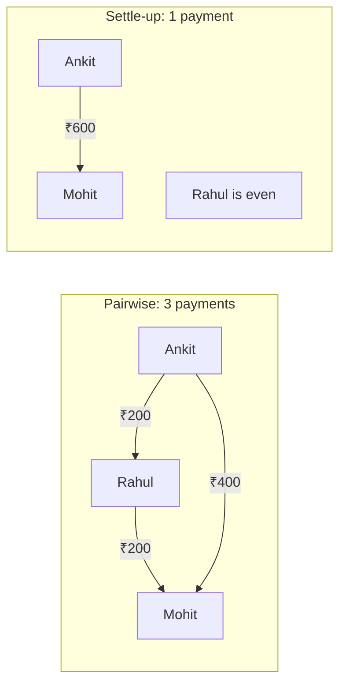
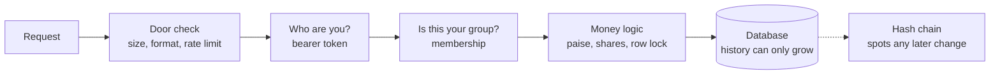
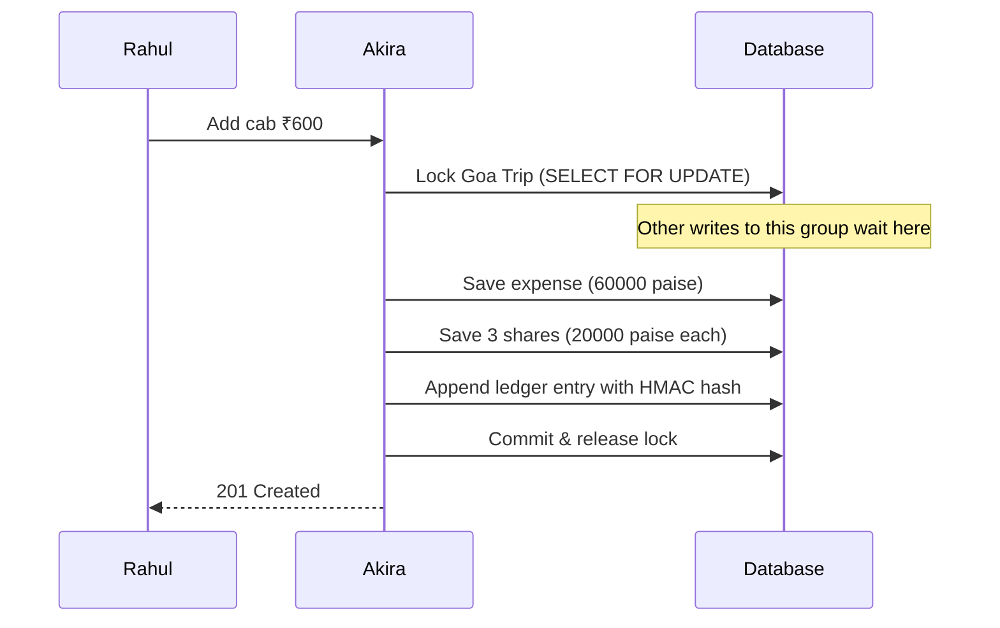
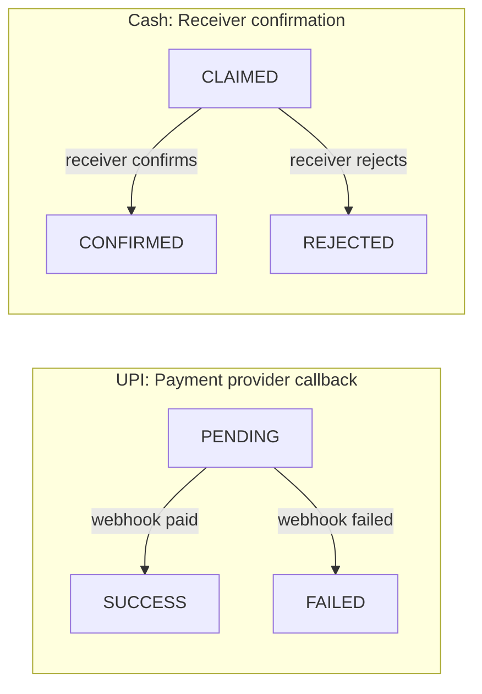
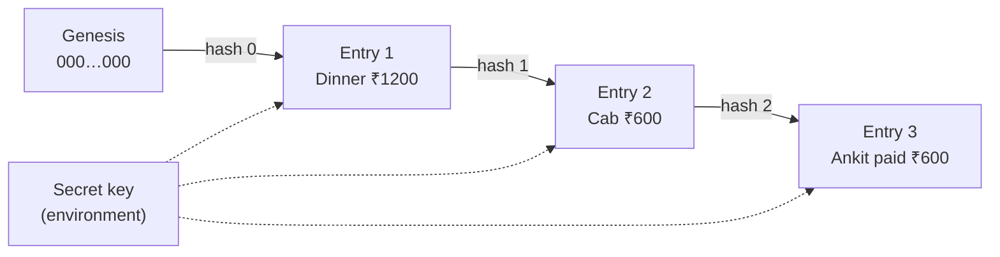
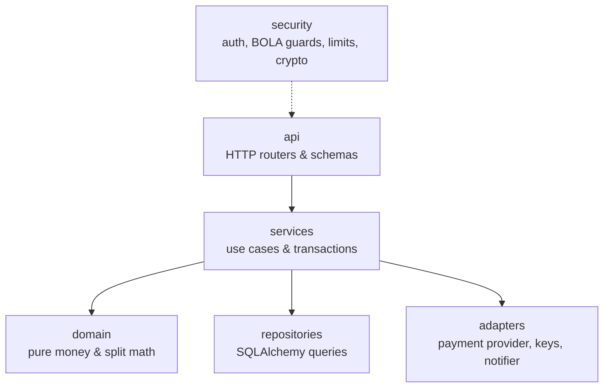
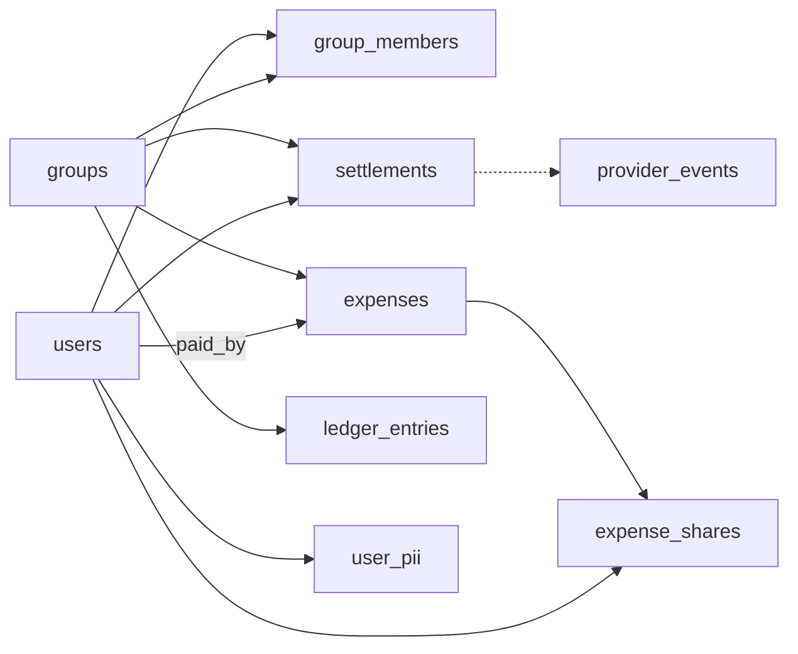
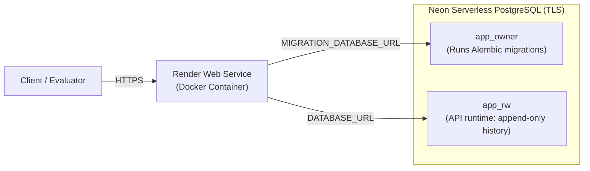

<p align="center">
  
</p>

# Akira: Splitting Expenses Without Losing Trust

Akira is a production-grade backend service for groups who share expenses: who paid, who owes, and who should pay whom. It is built with **FastAPI**, **PostgreSQL 16**, **SQLAlchemy 2.0**, and **Alembic**.

It started as the Decentro SDE intern assignment. The brief asks for users, groups, expenses, and balances, and all of that is here (Chapters 3 and 8). This document is mostly about the part the brief left open: **what it takes for people to believe the numbers a money app shows them.**

> **Short on time?** Read Chapter 1 and Chapter 2 (three minutes), then run the scripted demo in [Chapter 12](#chapter-12-critical-demo-walkthrough--screenshot-guide) (four minutes) to capture verified screenshots of the system in action. Chapter 7 lists every place where Akira deliberately differs from the brief, and why.

---

## Chapter 1: The trip

Mohit, Rahul, and Ankit go to Goa.

On the first night Mohit pays ₹1,200 for dinner. The next morning Rahul pays ₹600 for a cab. Ankit pays for nothing yet.

By the end of the trip, the question is simple: who owes whom?

```text
Dinner ₹1200 ÷ 3 = ₹400 each   → Rahul owes Mohit ₹400, Ankit owes Mohit ₹400
Cab    ₹600  ÷ 3 = ₹200 each   → Mohit owes Rahul ₹200, Ankit owes Rahul ₹200

After netting:   Rahul owes Mohit ₹200
                 Ankit owes Mohit ₹400
                 Ankit owes Rahul ₹200
```

That is three payments. But look at the net positions: Rahul is completely even (he is owed ₹200 and owes ₹200), Mohit is up ₹600, Ankit is down ₹600.

**One payment settles the whole trip: Ankit pays Mohit ₹600.** Akira suggests exactly that (Chapter 3.6).



The arithmetic is the easy part. The hard part is that this service holds a record of who owes money to whom, and a record like that is only useful if every person in the group trusts it.

---

## Chapter 2: Seven ways a simple expense app goes wrong

None of these are exotic. Each one happens to real money applications.

1. **The missing paisa.** ₹1,000 split three ways is ₹333.333… Round each share and you get ₹999.99. Somebody quietly paid a paisa nobody recorded. Do it a million times and the books no longer balance.  
   → *Chapter 3.1*
2. **The friend who joined late.** Sameer joins the group on day three. If shares are recalculated from "current members", Sameer suddenly owes part of a dinner he never ate, and everyone else's history changes.  
   → *Chapter 3.2*
3. **The double tap.** Rahul's network drops while he adds an expense. His phone retries. Now the cab appears twice.  
   → *Chapter 3.5*
4. **The two phones.** Ankit owes ₹50 and taps "settle" on his phone and laptop at the same moment. Both requests see ₹50 owed. Both succeed. He has now paid ₹100.  
   → *Chapters 3.4 and 4.4*
5. **The "I already paid".** Anyone can send a request saying "payment received". If the server believes it, debts can be cleared without money moving.  
   → *Chapter 4.4*
6. **The quiet edit.** Someone with direct database access changes the dinner from ₹1,200 to ₹200. The application was never involved, so no application check ran.  
   → *Chapter 5*
7. **The leaked backup.** A database backup ends up somewhere public. It contains every user's UPI ID.  
   → *Chapter 4.5*

Akira is organized around three questions that cover all seven cases:

| Dimension | Question | Chapter |
|---|---|---|
| **Correct** | Is the arithmetic always right, even under retries and parallel requests? | 3 |
| **Protected** | Can only the right people see and change a group's money? | 4 |
| **Provable** | If something was changed behind our back, will we know? | 5 |

Every request passes the same checks in the same order. The last step keeps watching after the request is gone:



---

## Chapter 3: Getting the arithmetic right

### 3.1 Money is whole paise
Every amount is stored and computed as an integer number of paise. ₹1,200 is `120000`. Floats are strictly prohibited anywhere money flows, and automated AST inspection tests enforce this across the entire repository. Rupee strings like `"1200.00"` exist only at the API edge.

When an amount does not divide evenly, leftover paise are allocated deterministically to participants in ascending user order. ₹1,000 ÷ 3 becomes ₹333.34, ₹333.33, ₹333.33. The rule is deterministic, splits always sum to the exact expense amount, and zero paise are ever lost.

### 3.2 Shares are frozen when the expense is recorded
The brief's suggested schema has an `expenses` table but no record of who shared each expense. Akira adds `expense_shares`: one immutable row per participant, holding what they owed **at that moment**.

When Sameer joins on day three, the dinner still belongs to three people because the frozen shares record it. This table also supports unequal splits (`EXACT` amounts, or `SHARES` weights like 2:1:1) without schema changes.

### 3.3 Balances are computed, never stored
There is no `balances` table. Every balance is computed dynamically from expenses, frozen shares, and confirmed settlements when requested.

A stored balance is a second copy of the truth, and copies drift: a bug, a crash between two writes, or a manual DB fix updates one and not the other. Computing balances from history guarantees single source of truth. Net balances across every group strictly sum to zero paise.

### 3.4 One writer per group at a time
Every mutation to a group (an expense or a settlement) starts by acquiring an exclusive row lock on PostgreSQL: `SELECT … FROM groups WHERE id = :id FOR UPDATE`. Concurrent requests for the same group wait until the first commits. Requests for different groups execute in parallel without contention.

This eliminates race conditions and prevents overpayment: the second request evaluates debts against state committed by the first.



### 3.5 Retries do not create duplicates
Write endpoints accept an `Idempotency-Key` header. Akira stores the key with a SHA-256 fingerprint of the request payload and the exact response.
- Same key, same payload → Returns cached response; no duplicate record created.
- Same key, different payload → Returns `422 IDEMPOTENCY_KEY_REUSED` to catch client bugs.

### 3.6 Product enhancement: settle up in the fewest payments
- **Problem:** Pairwise balances tell users what they owe, but not how to finish. In a group of six, pairwise debts can require up to 15 separate transfers, often routing money through people who are already net zero.
- **Why this feature:** Minimizing payments reduces UPI friction, fees, and transfer mistakes.
- **Algorithm:** `GET /groups/{id}/settle-up` executes a greedy debt-simplification algorithm that repeatedly matches the maximum debtor with the maximum creditor. Ties break deterministically by user ID. This produces at most $n - 1$ transfers. The algorithm is a pure domain function in `app/domain/settle.py` with zero I/O, covered by 100% unit tests.

---

## Chapter 4: Keeping the wrong people out

### 4.1 Who are you?
Creating a user returns an API token **once**. Every later request sends it as `Authorization: Bearer <token>`.
- The database stores only a SHA-256 hash of the token. A stolen database backup cannot be used to authenticate.
- Constant-time comparison (`hmac.compare_digest`) prevents timing attacks.
- `POST /users/me/token/rotate` invalidates the old token immediately.

### 4.2 Is this yours?
Every group route enforces that the caller is an active member of that group. Broken Object Level Authorization (OWASP API1) is prevented by returning `404 Not Found` (never `403 Forbidden`) for non-members. A 403 confirms the group exists, allowing attackers to enumerate resource IDs. A 404 reveals zero information.

### 4.3 Turning away bad requests early
Before requests reach domain logic:
- Payloads exceeding 64 KB receive `413 Request Entity Too Large`.
- Payloads with unknown fields receive `422 Unprocessable Entity` (`extra="forbid"` on all schemas).
- Rate limits reject abusive callers with `429 Too Many Requests` and `Retry-After`.
- Reverse proxy client IP extraction safely walks `X-Forwarded-For` from the right skipping `TRUSTED_PROXY_HOPS`, preventing client IP spoofing.

### 4.4 A payment only counts with proof
A settlement cannot be marked paid by client assertion. Akira implements an explicit state machine (`app/domain/settlement_state.py`):



Only `SUCCESS` and `CONFIRMED` update balances. When a UPI settlement initiates:
1. Akira locks the group row and validates the amount against outstanding net debt minus any currently `PENDING` settlements (preventing parallel overpayment).
2. It records the settlement as `PENDING` and releases the lock.
3. It invokes the mock payment provider outside the DB transaction.
4. When the provider calls the webhook, Akira verifies:
   - HMAC-SHA256 signature using the shared webhook secret.
   - Timestamp freshness within 300 seconds (preventing replay attacks).
   - Event idempotency via `provider_events` table (preventing duplicate processing).
   - Amount matching the registered settlement.

### 4.5 UPI IDs are encrypted with blind indexing
A user's Virtual Payment Address (UPI ID) is sensitive PII. Akira encrypts every UPI ID using **AES-256-GCM** with a fresh 96-bit random nonce and binds the user's public ID as authenticated associated data (AAD). Ciphertext copied to another user's row fails decryption.

To prevent duplicate UPI registrations without decrypting all records, Akira computes a **blind index**: `HMAC-SHA256(secret, lowercase UPI ID)`. A `UNIQUE` database constraint on the blind index prevents duplicate registrations cleanly. Plaintext UPI IDs are only decrypted when constructing payment links in the adapter; API responses mask them (`al***@okhdfcbank`).

---

## Chapter 5: Proving nothing was changed

### 5.1 The application can only add history, never rewrite it
Akira connects to PostgreSQL as `app_rw`, a least-privilege role that has `SELECT` and `INSERT` on history tables (`ledger_entries`, `expense_shares`, `provider_events`) but **no UPDATE and no DELETE privileges**. Schema migrations run as `app_owner`.

Even if application code suffers an injection bug, PostgreSQL enforces append-only immutability at the database engine level.

### 5.2 A hash chain that reveals tampering
Every expense and settlement appends an immutable record to `ledger_entries`. Each entry computes an HMAC-SHA256 hash chaining the previous entry's hash, sequence number, and entry payload:

$$\text{hash}_n = \text{HMAC-SHA256}(\text{key}, \text{hash}_{n-1} \parallel \text{entry}_n)$$



`GET /groups/{id}/audit/verify` walks the chain from genesis to head, recomputes each HMAC, and verifies sequence continuity and payload integrity. Any modified row, deleted entry, or reordered sequence causes verification to fail immediately:

```json
{"valid": true, "entries_checked": 3, "head_hash": "a4f89c...", "broken_at": null}
{"valid": false, "entries_checked": 2, "broken_at": 2, "reason": "hash_mismatch"}
```

HMAC requires an application secret key located outside the database, so an attacker with direct database access cannot forge valid hashes.

### 5.3 What the tests actually prove
All 175 tests run against real **PostgreSQL 16**. SQLite fallback is forbidden. The concurrency test suite executes parallel requests using separate database connections:

| Test Scenario | Result on PostgreSQL 16 |
|---|---|
| 20 expenses added to one group in parallel | Ledger sequence 1..20 without gaps, hash chain valid, net balances sum to zero |
| 10 parallel settlements against one ₹50 debt | Exactly 1 succeeds, 9 rejected with `422 OVERPAYMENT`, zero overpayment |
| Concurrent requests with identical `Idempotency-Key` | Exactly 1 record created, all callers receive identical `201` response |
| Database outage simulation | `/health` returns `503 degraded`, writes return `503 DATABASE_UNAVAILABLE`, zero partial writes |
| Direct `UPDATE`/`DELETE` on `ledger_entries` as `app_rw` | Rejected with `permission denied for table ledger_entries` by PostgreSQL |

Money and split logic in `app/domain/` has 100% test coverage. Overall test coverage is 93%.

---

## Chapter 6: What Akira does not protect against

- **Compromised application host:** Cryptographic keys reside in environment variables. A compromised application container can read keys and produce valid signatures.
- **Verification on demand:** `audit/verify` runs when invoked; automatic background polling is planned for v2.
- **Visible transaction amounts:** PostgreSQL requires plaintext amounts to evaluate `CHECK (amount_paise > 0)` and compute balances. A leaked database reveals transaction amounts, but never tokens or UPI IDs.
- **In-memory rate limiting:** Rate limits are tracked per process. Multiple replicas require a centralized store like Redis.
- **Mock payment provider:** The payment provider adapter implements complete signing, timeouts, and state transitions, but executes against mock endpoints.

---

## Chapter 7: Where Akira differs from the brief, and why

| Brief | Akira | Why |
|---|---|---|
| `POST /users` returns integer `{"id": 1}` | Returns `usr_...` and single-reveal `api_token` | Sequential integers allow ID enumeration; token establishes secure authentication. |
| Endpoints work unauthenticated | Group endpoints require `Authorization: Bearer <token>` | Without authentication, any actor can read or alter another group's debts. |
| `GET /users` returns all registered users | Returns only users sharing a group with caller | Privacy protection prevents leaking full user directories to arbitrary callers. |
| Add member body `{"group_id", "user_id"}` | `POST /groups/{id}/members` with `{"user_id"}` | Resource ID belongs in URI path; body redundantly exposing it causes parameter tampering. |
| `POST /expenses` at root | Supported, plus `POST /groups/{id}/expenses` | Nested route enforces group membership authorization consistently. |
| `GET /balances` returns names | Returns name-keyed balances plus ID-keyed net maps | Names collide; public user IDs guarantee unique resolution. Rupee strings avoid float truncation. |

---

## Chapter 8: Run it yourself

### With Docker (Recommended)

```bash
git clone https://github.com/AdityaP700/Akira.git && cd Akira
cp .env.example .env
# Set LOCAL_DB_PASSWORD and generate 32-byte hex keys:
# python -c "import secrets; print(secrets.token_hex(32))"
docker compose up --build
```
- API: `http://localhost:8000`
- Swagger UI docs: `http://localhost:8000/docs`
- Health check: `http://localhost:8000/health`

### Without Docker

Requires Python 3.12+ and PostgreSQL 16:

```bash
python -m venv .venv
# Linux/macOS: source .venv/bin/activate | Windows: .venv\Scripts\activate
pip install -e .
alembic upgrade head
uvicorn app.main:app --reload
```

### Seed Data & Postman

```bash
python scripts/seed_goa_trip.py
```
- Postman Collection: `postman/expense-sharing.postman_collection.json` (29 requests covering the entire Goa Trip lifecycle, token rotation, settlements, and audit verification).

---

## Chapter 9: How the code is organised

Akira follows hexagonal / clean architecture:

```text
app/
├── api/           FastAPI routers, Pydantic v2 schemas, auth dependencies
├── services/      Use-case services; each use case owns one DB transaction
├── domain/        Pure money math, splits, balances, settle-up, settlement state (No DB, No FastAPI)
├── repositories/  SQLAlchemy 2.0 models and repositories (Never commits on its own)
├── adapters/      External integration: MockPaymentProvider, EnvKeyProvider, DbNotifier
├── security/      Token auth, BOLA guards, IP rate limiting, AES-256-GCM encryption, HMAC signing
└── core/          Pydantic-settings config, error handlers, structured logging, public IDs
```



---

## Chapter 10: The database on one page



| Table | Description | Privilege for `app_rw` |
|---|---|---|
| `users` | Public IDs, names, SHA-256 token hashes | SELECT, INSERT, UPDATE |
| `user_pii` | AES-256-GCM encrypted UPI ID, nonce, blind index HMAC | SELECT, INSERT, UPDATE |
| `groups` | Public IDs, names, row-lock target for all group writes | SELECT, INSERT, UPDATE |
| `group_members` | Membership associations, joined timestamp | SELECT, INSERT, UPDATE, DELETE |
| `expenses` | Amounts in integer paise, descriptions, split types | SELECT, INSERT, UPDATE |
| `expense_shares` | Immutable snapshot of participant shares per expense | **SELECT, INSERT only** |
| `settlements` | Repayment records, settlement methods, status | SELECT, INSERT, UPDATE |
| `ledger_entries` | Hash-chained audit entries with previous hash and HMAC | **SELECT, INSERT only** |
| `idempotency_keys` | Fingerprinted requests and cached HTTP responses | SELECT, INSERT, UPDATE |
| `provider_events` | Webhook idempotency ledger for payment callbacks | **SELECT, INSERT only** |
| `notifications` | In-app user notifications | SELECT, INSERT, UPDATE (read_at only) |

---

## Chapter 11: Deployment

Akira is configured for production-grade cloud deployment on **Render** (API container) and **Neon** (Serverless PostgreSQL 16) connected over TLS.

### 11.1 Architecture & Role Separation



1. **Separation of Concerns:**
   - `app_owner`: Owns schema and tables; used solely by `alembic/env.py` during container startup in `scripts/start.sh`.
   - `app_rw`: Runtime database role used by FastAPI; cannot alter schema or drop tables, and cannot `UPDATE` or `DELETE` history records.
2. **Cold-Start Behavior:**
   - Free-tier Render web services spin down after 15 minutes of inactivity. The first incoming request incurs a ~50-second cold start while the container spins up and runs migrations.
   - Use `/health` for uptime monitoring and health checks.
3. **Payment Provider in Demo Profile:**
   - Deployed with `APP_ENV=demo`. Payments use the deterministic mock provider; responses carry `X-Environment: demo-mock-payments` and `/docs` remains enabled for evaluator testing.

### 11.2 Initializing Roles on Neon

Connect to your Neon database using your admin connection string (`neondb_owner`) and run `scripts/init_db_roles.sql`, passing your chosen passwords as `psql` variables:

```bash
psql "$NEON_ADMIN_DATABASE_URL" \
  -v app_owner_password="<your_chosen_owner_password>" \
  -v app_rw_password="<your_chosen_rw_password>" \
  -f scripts/init_db_roles.sql
```

This dynamically grants permissions on your Neon database without hardcoding credentials in source control.

### 11.3 Environment Variables Configuration

In the Render Dashboard (or via `render.yaml`), configure these environment variable names (mark secrets as `sync: false`):

| Variable Name | Description | Example / Notes |
|---|---|---|
| `DATABASE_URL` | Runtime PostgreSQL connection for `app_rw` | `postgresql+psycopg://app_rw:<pass>@<host>/neondb?sslmode=require` |
| `MIGRATION_DATABASE_URL` | Migration connection for `app_owner` | `postgresql+psycopg://app_owner:<pass>@<host>/neondb?sslmode=require` |
| `APP_ENV` | Application profile | `demo` (enables docs and mock payments) |
| `WEBHOOK_HMAC_KEY` | 32-byte hex secret for payment webhooks | Generate with `secrets.token_hex(32)` |
| `WEBHOOK_KEY_ID` | Key identifier for rotation | `whk_key_1` |
| `AUDIT_HMAC_KEY` | 32-byte hex secret for hash chain | Generate with `secrets.token_hex(32)` |
| `AUDIT_KEY_ID` | Key identifier for rotation | `aud_key_1` |
| `PII_ENC_KEY` | 32-byte hex key for AES-256-GCM | Generate with `secrets.token_hex(32)` |
| `PII_BLIND_INDEX_KEY` | 32-byte hex key for blind index HMAC | Generate with `secrets.token_hex(32)` |
| `PII_KEY_ID` | Key identifier for rotation | `pii_key_1` |
| `TRUSTED_PROXY_HOPS` | Trusted proxy hop count | `1` (matches Render's edge proxy; prevents IP spoofing) |

### 11.4 Live URL & Postman Configuration

- **Live Deployed URL:** `https://akira-expense-sharing.onrender.com` *(placeholder)*
- **Postman Execution:**
  1. Open `postman/expense-sharing.postman_collection.json` in Postman.
  2. Set the collection variable `base_url` to `https://akira-expense-sharing.onrender.com` (defaults to `http://localhost:8000` for local testing).
  3. Run the collection sequentially: tokens and IDs automatically propagate across requests.

---

## Chapter 12: Critical Demo Walkthrough & Screenshot Guide

This chapter provides the exact curl commands and expected outputs to verify all core claims of the system. Run them in order to capture verification screenshots.

```bash
export BASE_URL="http://localhost:8000"
```

### Test 1: User Signup & One-Time Token Reveal
Create user Mohit. Verify that `api_token` is returned once.

```bash
curl -s -X POST "$BASE_URL/users" \
  -H "Content-Type: application/json" \
  -d '{"name": "Mohit"}'
```
**Expected Response:**
```json
{
  "id": "usr_0192d1a2b3c4",
  "name": "Mohit",
  "api_token": "est_7a8b9c0d1e2f3a4b5c6d7e8f9a0b1c2d"
}
```
> **Screenshot highlight:** Notice the `api_token` prefix `est_`. The database stores only its SHA-256 hash.

### Test 2: Seed the Goa Trip & Check Net Balances
Seed the trip (Mohit pays ₹1,200 dinner, Rahul pays ₹600 cab, Ankit pays ₹0):

```bash
python scripts/seed_goa_trip.py
```
Check balances:
```bash
curl -s "$BASE_URL/groups/$GROUP_ID/balances" \
  -H "Authorization: Bearer $MOHIT_TOKEN"
```
**Expected Response:**
```json
{
  "group_id": "grp_goa_trip",
  "net": {
    "usr_mohit": "600.00",
    "usr_rahul": "0.00",
    "usr_ankit": "-600.00"
  }
}
```
> **Screenshot highlight:** Net balance sum is exactly ₹0.00. Rahul is completely even.

### Test 3: Settle-Up Optimal Transfer Calculation
Query the settle-up endpoint to find the minimum number of payments:

```bash
curl -s "$BASE_URL/groups/$GROUP_ID/settle-up" \
  -H "Authorization: Bearer $MOHIT_TOKEN"
```
**Expected Response:**
```json
{
  "group_id": "grp_goa_trip",
  "transfers": [
    {
      "from_user_id": "usr_ankit",
      "to_user_id": "usr_mohit",
      "amount": "600.00",
      "amount_paise": 60000
    }
  ]
}
```
> **Screenshot highlight:** Exactly 1 transfer settles the entire trip instead of 3 pairwise transfers.

### Test 4: Cryptographic Ledger Audit Verification
Verify the HMAC-SHA256 hash chain:

```bash
curl -s "$BASE_URL/groups/$GROUP_ID/audit/verify" \
  -H "Authorization: Bearer $MOHIT_TOKEN"
```
**Expected Response:**
```json
{
  "valid": true,
  "entries_checked": 2,
  "head_hash": "e3b0c44298fc1c149afbf4c8996fb92427ae41e4649b934ca495991b7852b855",
  "broken_at": null,
  "reason": null
}
```
> **Screenshot highlight:** `valid: true` confirms no row was altered, inserted, or deleted outside the application.

### Test 5: Overpayment & Concurrency Defense
Attempt to settle ₹700.00 when Ankit only owes ₹600.00:

```bash
curl -s -X POST "$BASE_URL/groups/$GROUP_ID/settlements" \
  -H "Authorization: Bearer $ANKIT_TOKEN" \
  -H "Content-Type: application/json" \
  -d '{"payee_id": "usr_mohit", "amount": "700.00", "method": "UPI"}'
```
**Expected Response (HTTP 422):**
```json
{
  "error": {
    "code": "OVERPAYMENT",
    "message": "Settlement amount 70000 paise exceeds net debt 60000 paise",
    "request_id": "req_0192d1b2c3d4"
  }
}
```
> **Screenshot highlight:** Rejected before payment creation, preventing double-tap overpayment.

### Test 6: Database Role Privilege Defense
Prove that the runtime application role (`app_rw`) cannot rewrite history in PostgreSQL:

```bash
docker exec akira-db psql -U app_rw -d akira -c "UPDATE ledger_entries SET payload='tampered';"
```
**Expected Output:**
```text
ERROR: permission denied for table ledger_entries
```
> **Screenshot highlight:** Engine-level permission denial proves history is immutable even under SQL injection.

### Test 7: Anti-Spoofing Proxy Rate Limiting
Send a request with a spoofed leftmost IP header:

```bash
curl -s -I "$BASE_URL/health" -H "X-Forwarded-For: 1.1.1.1, 203.0.113.195"
```
**Container Startup/Debug Log:**
```json
{"event": "client_ip_extracted", "ip": "203.0.113.195", "raw_header": "1.1.1.1, 203.0.113.195", "hops": 1}
```
> **Screenshot highlight:** The system extracts `203.0.113.195` (appended by trusted proxy) and rejects spoofed `1.1.1.1`.

---

## Chapter 13: What I would do next

- **Full Double-Entry Postings:** Structure transactions as balance-summing ledger postings so the database enforces conservation of money across all operations.
- **Automated Audit Cron:** Run `audit/verify` on a scheduled background worker and anchor daily hash chain heads to public transparency logs.
- **Cloud KMS Integration:** Transition from environment variables to AWS KMS or Google Cloud KMS with per-user data encryption keys for cryptographic right-to-be-forgotten.
- **Row-Level Security (RLS):** Implement PostgreSQL RLS policies so group tenant isolation is enforced at the query engine level.

---

## Docs Map

- [`docs/API.md`](docs/API.md): Complete OpenAPI endpoint specification with request and response examples.
- [`docs/SCHEMA.md`](docs/SCHEMA.md): Database tables, constraints, column types, and least-privilege roles.
- [`docs/SECURITY.md`](docs/SECURITY.md): Threat model, OWASP API Security Top 10 mitigations, and crypto review.
- [`CHANGELOG.md`](CHANGELOG.md): Complete audit log of every change and architectural decision.
- [`REVIEW_NOTES.md`](REVIEW_NOTES.md): Step-by-step verification notes for reviewers.
