# START_HERE.md

## Setup

1. Create an empty repo folder. Copy everything from this kit into its root (keep `prompts/` and `docs/design/`).
2. Put the assignment PDF in `docs/assignment/`.
3. Open the folder in Antigravity. Run the prompts below **one at a time**, in order. Start each in a fresh agent session if the previous one got long; the agent re-reads `AGENTS.md`, `GUARDRAILS.md`, `CHANGELOG.md` and `REVIEW_NOTES.md` every time, so nothing depends on chat memory.
4. After each prompt: check the commit, the new `CHANGELOG.md` entry and the `REVIEW_NOTES.md` entry. Push yourself when you are happy (the agent only commits).
5. Whenever the agent asks about `.env`, fill the values yourself. Generate keys with:
   `python -c "import secrets; print(secrets.token_hex(32))"`

## Phase order

```mermaid
flowchart LR
    subgraph Baseline["Baseline v1 — meets the full brief"]
      B0[B0 bootstrap] --> B1[B1 domain logic] --> B2[B2 schema] --> B3[B3 users & groups] --> B4[B4 expenses] --> B5[B5 balances & settle-up] --> B6[B6 release]
    end
    subgraph Advanced["Advanced v2 — security, privacy, lifecycle"]
      A1[A1 auth & BOLA] --> A2[A2 edge hardening] --> A3[A3 settlement lifecycle] --> A4[A4 HMAC ledger] --> A5[A5 PII & DB roles] --> A6[A6 proofs & final]
    end
    B6 --> A1
```

| Prompt | Delivers | Heavy (sub-agents allowed)? |
|---|---|---|
| `prompts/baseline/B0_bootstrap.md` | Skeleton, Docker, CI, `/health` | No |
| `prompts/baseline/B1_domain_logic.md` | Money parsing, split strategies, balances, settle-up (pure + tests) | No |
| `prompts/baseline/B2_schema_and_repositories.md` | Schema shaped for advanced phases, repositories | No |
| `prompts/baseline/B3_users_groups_api.md` | Users, groups, members, pagination, error format | No |
| `prompts/baseline/B4_expenses_atomic_idempotent.md` | Atomic, locked, idempotent expenses | No |
| `prompts/baseline/B5_balances_settleup.md` | Balances in brief format, settle-up, settlements | No |
| `prompts/baseline/B6_baseline_release.md` | README, API docs, seed, Postman, requirement audit | Yes (audit) |
| `prompts/advanced/A1_auth_and_object_authorization.md` | Bearer tokens, membership checks | No |
| `prompts/advanced/A2_edge_hardening_and_observability.md` | Limits, rate limiting, headers, masked logs | No |
| `prompts/advanced/A3_settlement_lifecycle_and_webhooks.md` | PENDING→SUCCESS/FAILED, signed webhook, fallback, cash claim/confirm, notifications | Yes |
| `prompts/advanced/A4_tamper_evident_ledger.md` | HMAC hash chain + verify | No |
| `prompts/advanced/A5_pii_protection_and_db_roles.md` | Encrypted VPA, blind index, SHARES split, least-privilege role | Yes |
| `prompts/advanced/A6_proofs_threat_model_final.md` | Concurrency proofs, threat model, final docs, demo script | Yes (independent reviewer) |

Stopping after B6 still gives a complete submission. Each advanced phase is additive and can be dropped if time runs out; drop in reverse order of value: A5 → A2 → A4.

## Data

No external dataset is needed. `scripts/seed_goa_trip.py` (B6) creates the demo data, and tests generate random expenses with a fixed seed.

## UI

None. The deliverable is a backend server; the demo uses Swagger (`/docs`, dev only) and the Postman collection.
