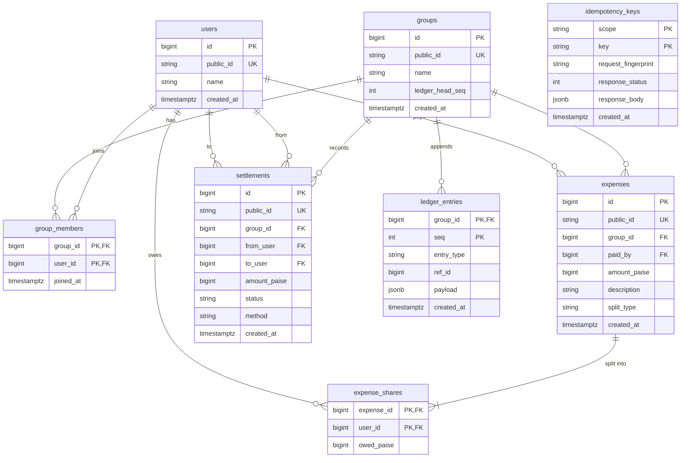

# Database Schema Documentation

This document describes the relational database schema, integrity constraints, indexes, and design decisions for the Expense Sharing Service.

The database serves as the final line of defence for financial correctness. It is designed to meet the baseline requirements while being shaped for advanced phases (append-only ledger, idempotency, settlement lifecycles) as additive migrations without rewrites.

---

## 1. Entity-Relationship Diagram

---

## 2. Table Specifications

### 2.1 `users`
Represents registered participants.
- `id`: `BIGINT PRIMARY KEY GENERATED BY DEFAULT AS IDENTITY` — Internal surrogate key.
- `public_id`: `VARCHAR(32) UNIQUE NOT NULL` — External opaque ID (`usr_...`).
- `name`: `VARCHAR(100) NOT NULL` — Display name. Constraint: `CHECK (length(trim(name)) BETWEEN 1 AND 100)`.
- `created_at`: `TIMESTAMPTZ NOT NULL DEFAULT now()` — Registration timestamp.

### 2.2 `groups`
Represents expense sharing groups.
- `id`: `BIGINT PRIMARY KEY GENERATED BY DEFAULT AS IDENTITY` — Internal surrogate key.
- `public_id`: `VARCHAR(32) UNIQUE NOT NULL` — External opaque ID (`grp_...`).
- `name`: `VARCHAR(100) NOT NULL` — Group name. Constraint: `CHECK (length(trim(name)) BETWEEN 1 AND 100)`.
- `ledger_head_seq`: `INT NOT NULL DEFAULT 0` — Monotonically increasing sequence number of the ledger head. Updated on every write under `SELECT ... FOR UPDATE`.
- `created_at`: `TIMESTAMPTZ NOT NULL DEFAULT now()` — Creation timestamp.

### 2.3 `group_members`
Association table tracking membership.
- `group_id`: `BIGINT NOT NULL REFERENCES groups(id) ON DELETE RESTRICT`
- `user_id`: `BIGINT NOT NULL REFERENCES users(id) ON DELETE RESTRICT`
- `joined_at`: `TIMESTAMPTZ NOT NULL DEFAULT now()`
- **Primary Key:** `(group_id, user_id)`

### 2.4 `expenses`
Records expenses paid by a group member.
- `id`: `BIGINT PRIMARY KEY GENERATED BY DEFAULT AS IDENTITY`
- `public_id`: `VARCHAR(32) UNIQUE NOT NULL` — External opaque ID (`exp_...`).
- `group_id`: `BIGINT NOT NULL REFERENCES groups(id) ON DELETE RESTRICT`
- `paid_by`: `BIGINT NOT NULL REFERENCES users(id) ON DELETE RESTRICT`
- `amount_paise`: `BIGINT NOT NULL CHECK (amount_paise > 0 AND amount_paise <= 100000000)` — Strict positive integer paise up to ₹10,00,000.
- `description`: `VARCHAR(200) NOT NULL CHECK (length(trim(description)) BETWEEN 1 AND 200)`
- `split_type`: `VARCHAR(20) NOT NULL CHECK (split_type IN ('EQUAL', 'EXACT', 'SHARES'))`
- `created_at`: `TIMESTAMPTZ NOT NULL DEFAULT now()`
- **Index:** `ix_expenses_group_created_id (group_id, created_at DESC, id DESC)` — For fast cursor pagination of expense history.

### 2.5 `expense_shares`
Stores the individual owed shares for an expense.
- `expense_id`: `BIGINT NOT NULL REFERENCES expenses(id) ON DELETE RESTRICT`
- `user_id`: `BIGINT NOT NULL REFERENCES users(id) ON DELETE RESTRICT`
- `owed_paise`: `BIGINT NOT NULL CHECK (owed_paise >= 0)`
- **Primary Key:** `(expense_id, user_id)`
- **Index:** `ix_shares_user_id (user_id)` — For user balance rollups across groups.

### 2.6 `settlements`
Records balance settlements between group members.
- `id`: `BIGINT PRIMARY KEY GENERATED BY DEFAULT AS IDENTITY`
- `public_id`: `VARCHAR(32) UNIQUE NOT NULL` — External opaque ID (`stl_...`).
- `group_id`: `BIGINT NOT NULL REFERENCES groups(id) ON DELETE RESTRICT`
- `from_user`: `BIGINT NOT NULL REFERENCES users(id) ON DELETE RESTRICT`
- `to_user`: `BIGINT NOT NULL REFERENCES users(id) ON DELETE RESTRICT`
- `amount_paise`: `BIGINT NOT NULL CHECK (amount_paise > 0 AND amount_paise <= 100000000)`
- `status`: `VARCHAR(20) NOT NULL DEFAULT 'CONFIRMED' CHECK (status IN ('PENDING', 'SUCCESS', 'FAILED', 'CLAIMED', 'CONFIRMED', 'REJECTED'))`
- `method`: `VARCHAR(20) NOT NULL DEFAULT 'OTHER' CHECK (method IN ('UPI', 'CASH', 'OTHER'))`
- `created_at`: `TIMESTAMPTZ NOT NULL DEFAULT now()`
- **Constraints:** `CHECK (from_user <> to_user)` — Users cannot settle debts with themselves.
- **Index:** `ix_settlements_group_created (group_id, created_at DESC)`

### 2.7 `ledger_entries`
Tamper-evident, append-only financial audit log.
- `group_id`: `BIGINT NOT NULL REFERENCES groups(id) ON DELETE RESTRICT`
- `seq`: `INT NOT NULL` — Strictly contiguous sequence starting from 1.
- `entry_type`: `VARCHAR(20) NOT NULL CHECK (entry_type IN ('EXPENSE', 'SETTLEMENT', 'REVERSAL'))`
- `ref_id`: `BIGINT NOT NULL` — References either `expenses.id` or `settlements.id`.
- `payload`: `JSONB NOT NULL` — Full snapshot of the transaction data.
- `created_at`: `TIMESTAMPTZ NOT NULL DEFAULT now()`
- **Primary Key:** `(group_id, seq)`

### 2.8 `idempotency_keys`
Prevents duplicate POST operations and concurrent duplicate writes.
- `scope`: `VARCHAR(100) NOT NULL` (e.g. `'expenses'`, `'settlements'`)
- `key`: `VARCHAR(255) NOT NULL` — Provided in `Idempotency-Key` header.
- `request_fingerprint`: `VARCHAR(64) NOT NULL` — SHA256 of normalized request body.
- `response_status`: `INT NULL` — Cached HTTP status code.
- `response_body`: `JSONB NULL` — Cached JSON response payload.
- `created_at`: `TIMESTAMPTZ NOT NULL DEFAULT now()`
- **Primary Key:** `(scope, key)`

---

## 3. Design Decisions & Tradeoffs (Why Each Choice)

1. **`expense_shares` Snapshot Table:**
   - *Why:* Storing explicit owed shares per user freezes who participated in the split at the exact time the expense was created. If group members join or leave later, past expense history remains completely untouched. It allows unequal splits (EXACT, SHARES) seamlessly and enables database-level assertion that `SUM(owed_paise) = amount_paise`.
2. **Integer Paise (`BIGINT`):**
   - *Why:* IEEE 754 floating-point numbers cannot accurately represent base-10 decimals like `0.10` or `0.01` without cumulative rounding errors. Integer paise ensures that every arithmetic operation, split division, and summation is exact.
3. **No Stored Balance Table (Derived Balances):**
   - *Why:* Balances are derived directly from expenses, shares, and settlements. A stored balance column can drift or get out of sync during concurrent updates or rollback anomalies. In v1, computing derived balances on demand guarantees 100% consistency.
4. **`ON DELETE RESTRICT` Everywhere:**
   - *Why:* Financial and audit history must never be accidentally wiped out by a cascading delete. If a user or group has recorded financial transactions, deleting them is strictly prohibited at the database constraint level.
5. **Append-Only Ledger (`ledger_entries`):**
   - *Why:* Every write operation that modifies money records an immutable entry in the group's ledger under a row-level lock (`SELECT ... FOR UPDATE` on `groups`). This guarantees consecutive sequence numbers and creates a tamper-evident audit trail ready for HMAC hash chaining in Advanced Phase A4.
6. **Opaque Public IDs vs Internal Serial IDs:**
   - *Why:* Internal integer IDs (`BIGINT`) are efficient for joins and indexes, but leaking sequential integers to the API invites enumeration attacks and reveals business metrics. Prefixed opaque identifiers (`usr_...`, `grp_...`, `exp_...`, `stl_...`) provide safe public references.
