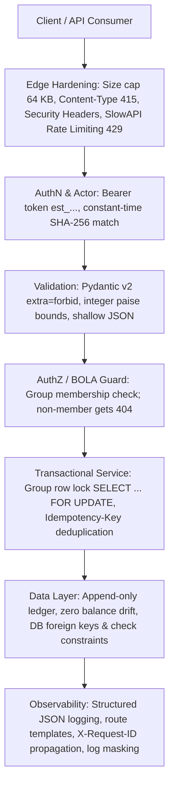
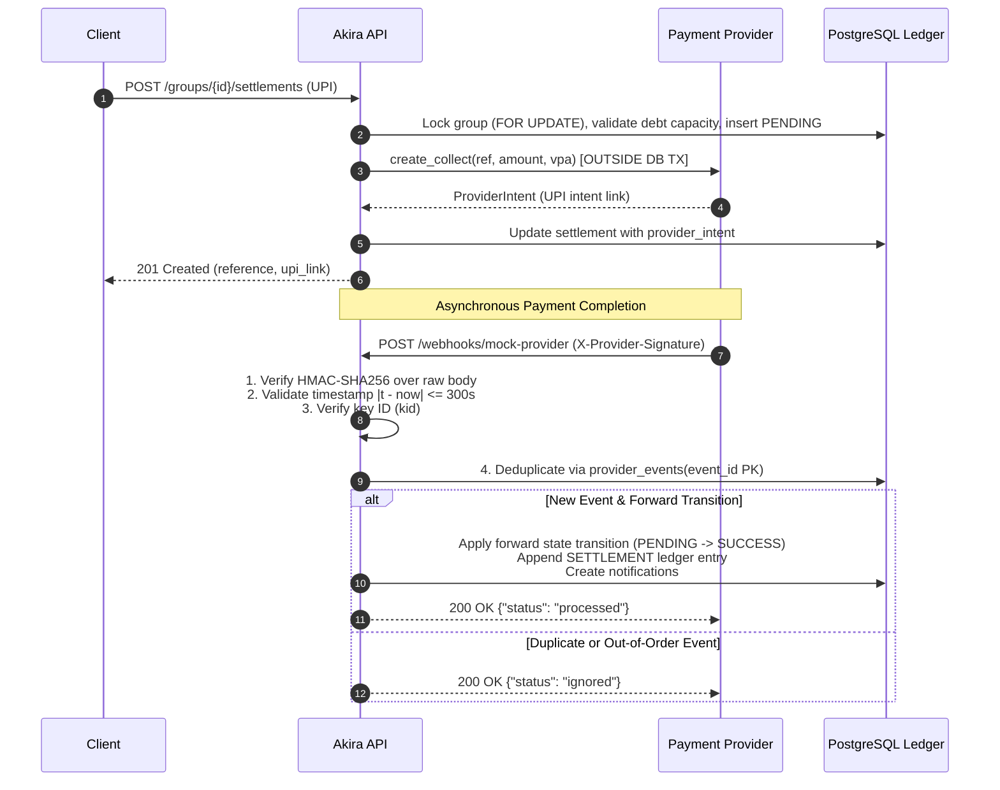

# SECURITY.md — Security Architecture & Threat Model

Trust and financial correctness are fundamental to Akira. Security is engineered in concentric layers: each layer assumes the outer boundary can fail.

---

## 1. OWASP API Security Top 10 (2023) Threat & Control Matrix

| OWASP Risk | Threat Description in Akira | Architecture & Implementation Control | Verification Test Name |
|---|---|---|---|
| **API1:2023 Broken Object Level Authorization (BOLA)** | Attacker accesses or modifies another group's expenses, balances, or members by guessing/substituting `group_id`. | `app/security/guards.py::require_member` / `require_member_and_lock` validates caller membership on every group-scoped route. Non-members receive an identical 404 `NOT_FOUND` ("Group '{id}' not found") preventing group ID enumeration. | `tests/api/test_auth_and_bola.py::test_bola_non_member_gets_404_on_all_group_routes` |
| **API2:2023 Broken Authentication** | Compromised user credentials, weak tokens, or token leaks leading to unauthorized account takeover. | Cryptographically strong 32-byte tokens (`est_` prefix + `secrets.token_urlsafe(32)`). Stored solely as SHA-256 hashes in database (`users.token_hash`). Constant-time comparison via `hmac.compare_digest`. One-click token rotation via `POST /users/me/token/rotate`. | `tests/api/test_auth_and_bola.py::test_registration_returns_token_and_hashes_in_db`, `test_authentication_failures`, `test_token_rotation` |
| **API3:2023 Broken Object Property Level Authorization** | Client modifies read-only fields (e.g. injects internal IDs, timestamps, settlement status) or receives excessive sensitive properties. | Strict Pydantic v2 schemas enforcing `extra="forbid"`. Separate input schemas (`UserIn`, `ExpenseIn`, `SettlementIn`) from output schemas. Clients can never set internal IDs, public IDs, statuses, or timestamps. Data minimisation: `GET /users` returns only users sharing groups with actor; `GET /balances` only lists actor's groups. | `tests/api/test_users_groups.py::test_create_user_validation_errors`, `tests/api/test_auth_and_bola.py::test_users_directory_limited_to_shared_groups`, `test_balances_limited_to_actor_groups` |
| **API4:2023 Unrestricted Resource Consumption** | Flooding requests or transmitting massive payloads causing server denial-of-service or memory exhaustion. | Edge hardening middleware enforces a strict 64 KB maximum request body size cap (Content-Length and streamed) returning 413 `PAYLOAD_TOO_LARGE`. `slowapi` rate limiting per token (60/min default) and per IP (5/min for registration, 10/min for settlements) returning 429 `RATE_LIMITED` with `Retry-After`. Keyset pagination with bounded page limits (`limit=20`, max 100). | `tests/api/test_edge_hardening.py::test_payload_too_large_content_length_header`, `test_payload_too_large_actual_streamed_body`, `test_rate_limiting_enforcement_and_retry_after` |
| **API5:2023 Broken Function Level Authorization** | Regular user invokes administrative or webhook endpoints. | All routes require Bearer token authentication except public registration (`POST /users`) and health probes (`GET /health`). Group creation auto-enrolls creator as member; only existing members can add new members. Webhook callbacks (Phase A3) require provider HMAC signatures, not user tokens. | `tests/api/test_auth_and_bola.py::test_group_creator_is_first_member`, `test_only_members_can_add_members` |
| **API6:2023 Unrestricted Access to Sensitive Business Flows** | Excessive rapid settlement transactions or automated financial spam. | Tightened rate limits on settlement creation (`POST /groups/{id}/settlements` capped at 10/min). Idempotency keys (`Idempotency-Key` header) prevent duplicate transaction execution on network retries or double clicks. | `tests/api/test_expenses.py::test_idempotency_key_replay_and_conflict`, `tests/api/test_edge_hardening.py::test_rate_limiting_enforcement_and_retry_after` |
| **API7:2023 Server-Side Request Forgery (SSRF)** | Attacker forces the backend server to make outbound requests to arbitrary or private network endpoints. | Stated out-of-scope / Not applicable: The service never accepts user-supplied destination URLs, fetches webhooks from user input, or makes outbound dynamic HTTP requests based on user parameters. | Architecture audit (no dynamic external fetch in services or repositories) |
| **API8:2023 Security Misconfiguration** | Verbose error stack traces, unhardened HTTP headers, open CORS, or unvalidated Content-Types. | Defensive HTTP security headers (`X-Content-Type-Options: nosniff`, `Cache-Control: no-store`, `Content-Security-Policy: frame-ancestors 'none'`, `Referrer-Policy: no-referrer`, HSTS in production). Non-JSON write payloads rejected with 415 `UNSUPPORTED_MEDIA_TYPE`. CORS disabled (no browser client). Global exception handlers sanitize all 500 errors to generic JSON envelopes with zero stack trace leakage. | `tests/api/test_edge_hardening.py::test_reject_non_json_content_types`, `test_security_headers_present_on_all_responses`, `test_hsts_header_present_in_prod_mode`, `test_unhandled_exception_returns_generic_500_without_stack_trace` |
| **API9:2023 Improper Inventory Management** | Stale API versions, exposed documentation, or test/mock routes accessible in production. | Interactive documentation (`/docs`, `/redoc`, `/openapi.json`) is strictly disabled when `APP_ENV=prod`. API routes maintain backward compatibility with assignment brief specification aliases (`POST /expenses`, `GET /balances`). | `tests/api/test_edge_hardening.py::test_api_docs_accessible_in_dev_mode`, `test_api_docs_disabled_in_prod_mode` |
| **API10:2023 Unsafe Consumption of APIs** | Blindly trusting external third-party webhook payloads or provider callbacks. | Webhook payloads (Phase A3) validated with HMAC-SHA256 signature, timestamp replay window ($\pm 300\text{ s}$), monotonic state transitions (`PENDING \to CONFIRMED \| FAILED`), and unique event ID deduplication. Structured log masking strips tokens, signatures, VPAs, and phone numbers. | `tests/api/test_edge_hardening.py::test_log_masking_filter_and_formatter` |

---

## 2. Defensive Security Layers

---

## 3. Rate Limiting Details & Trade-offs

- **Implementation:** `slowapi` in-memory limiter backed by `limits` library.
- **Key Strategy:**
  - Authenticated requests are bucketed by the SHA-256 hash of their Bearer token (`token:<hash>`).
  - Unauthenticated requests (e.g. `POST /users`) are bucketed by client IP (`ip:<host>`).
- **Configurable Limits:**
  - `RATE_LIMIT_USER_REGISTRATION`: 5 per minute (IP based).
  - `RATE_LIMIT_AUTHENTICATED`: 60 per minute (Token based).
  - `RATE_LIMIT_SETTLEMENTS`: 10 per minute (Token/IP based).
- **Production Trade-off:** In-memory rate limiting is process-local. In a horizontally scaled production deployment with multiple Uvicorn worker processes or containers, rate limit counters would be stored in a distributed key-value store (e.g. Redis).

---

## 4. Webhook Integrity & Payment Lifecycle Security (OWASP API10)

Akira implements bank-grade defenses against unsafe API consumption, replay attacks, and state race conditions in external payment callbacks:

### Key Security Controls:
1. **Raw Body HMAC Verification:** Webhook signatures are computed strictly over raw bytes (`v1 = HMAC_SHA256(key[kid], f"{t}.{raw_body}")`). Parsing occurs only *after* cryptographic verification succeeds.
2. **Replay Window Enforcement:** Webhooks with timestamp drift exceeding $\pm 300	ext{ s}$ are rejected immediately with 401 `STALE_TIMESTAMP`.
3. **Constant-Time Digest Comparison:** Signature validation uses `hmac.compare_digest` to prevent timing attacks.
4. **Idempotency & Deduplication:** Every webhook event is recorded in `provider_events(event_id PK)`. Redelivered events are safely acknowledged with HTTP 200 without executing duplicate mutations.
5. **Monotonic Forward-Only State Transitions:** Terminal statuses (`SUCCESS`, `FAILED`) cannot be overridden. Out-of-order or delayed webhooks (e.g. `FAILED` arriving after `SUCCESS`) are safely ignored.
6. **Debt Reservation Under Concurrency:** In-flight settlements (`PENDING`, `CLAIMED`) reserve allowable pairwise debt capacity. Concurrent requests attempting to settle the same debt in parallel are rejected with 422 `OVERPAYMENT`.
7. **Isolation of Foreign Calls:** Provider interactions occur strictly outside database transactions. Database connections are never held open during network I/O.
8. **Sensitive Data Masking:** Webhook signatures, provider tokens, VPAs, and phone numbers are redacted in all structured access logs via `MaskingFilter`.
