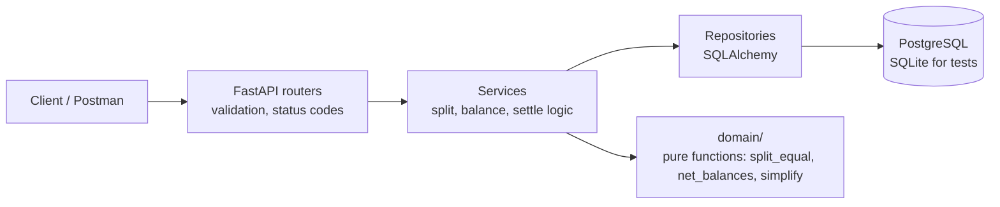

# PROJECT_PLAN.md — Expense Sharing Service (Decentro SDE Intern)

## 1. What is being graded

| Area | Weight | What actually earns it |
|---|---|---|
| Database design | 30% | Store **who owes what per expense** (shares table), money as integer paise, constraints, indexes |
| Problem solving & logic | 30% | Correct equal split with a documented rounding rule; balances that always sum to zero; clear netting |
| Backend implementation | 20% | One DB transaction per write, validation, correct status codes, one error format |
| Code quality | 10% | Layers (routes → services → repositories), small functions, tests |
| Product enhancement | 10% | One money-relevant feature with why / problem / design / tradeoffs |

The brief says "not production-grade". Correctness, clean code and explained decisions beat extra infrastructure.

## 2. Scope (deliberately narrow)

**Build:** users, groups, membership, expenses (equal split), expense history, balances, **settle-up suggestions + record settlement** (the enhancement), unequal splits (bonus, nearly free with the shares table), tests, Docker.

**Also build (security, see SECURITY_AND_STACK.md):** per-user bearer tokens (hashed), membership checks on every group route, HMAC-signed mock-provider webhooks with replay protection, encrypted UPI VPA + blind index, HMAC hash-chained ledger with verify endpoint, rate limits, least-privilege DB role, masked JSON logs, notifications table written in the same transaction, claim→confirm for cash settlements, EQUAL/EXACT/SHARES splits.

**Do not build:** OAuth/JWT/sessions, Redis, queues, microservices, event sourcing, full double-entry ledger, frontend, multi-currency, AI features. Mention them once under "With more time".

**Feature gate (for anything new mid-build).** Add it only if all four are yes; otherwise it goes to "With more time". Log the decision in CHANGELOG either way.
1. Does it raise a graded area (DB, logic, backend, code quality, enhancement)?
2. Can it ship with tests in under 1 hour?
3. Does it leave existing tests and the schema intact?
4. Can it be justified in two sentences in the interview?

**JD alignment (Decentro):** REST API design, DB design, speed/scalability reasoning, security basics (validation, no secrets in repo, idempotency), CI/CD (GitHub Actions running tests), clean documented code, product thinking.

## 3. Assumptions (copy into README)

| # | Ambiguity | Decision |
|---|---|---|
| A1 | Currency | INR only. Stored as `BIGINT` paise. API accepts rupees with ≤ 2 decimals as a string or number and returns strings like `"400.00"`. |
| A2 | Who shares an equal-split expense | Members of the group **at the time the expense is created**, snapshotted in `expense_shares`. |
| A3 | Member added later | Shares only expenses created after joining. Past expenses unchanged. |
| A4 | Removing a member | Not supported in v1 (would need a zero-balance check). |
| A5 | Rounding (₹1000 / 3) | Floor division in paise; the leftover paise go one each to members in ascending `user_id` order → 33334, 33333, 33333. Shares always sum exactly to the amount. |
| A6 | Payer not in group | 422 `PAYER_NOT_MEMBER`. |
| A7 | Group with only the payer | Allowed but creates no debt; returns 201 with a warning field. (Alternative: reject. Documented either way.) |
| A8 | Duplicate user names | Allowed; ids are the identity. Name-keyed balance output is kept for spec compatibility and ids are also returned. |
| A9 | `GET /balances` scope | Per group (`/groups/{id}/balances`) is primary; `/users/{id}/balances` gives a cross-group view; `/balances` returns all groups to match the spec. |
| A10 | Editing/deleting expenses | Not supported in v1; corrections are new entries (append-only). |

## 4. Architecture



- `domain/` holds pure functions (no DB) so rounding, netting and simplification are unit-tested in isolation.
- Every write (expense + its shares, settlement) runs in **one transaction**.

## 5. Database schema

```sql
users(
  id            BIGSERIAL PK,
  name          TEXT NOT NULL CHECK (length(trim(name)) > 0),
  created_at    TIMESTAMPTZ NOT NULL DEFAULT now()
)

groups(
  id            BIGSERIAL PK,
  name          TEXT NOT NULL,
  created_at    TIMESTAMPTZ NOT NULL DEFAULT now()
)

group_members(
  group_id      BIGINT REFERENCES groups(id),
  user_id       BIGINT REFERENCES users(id),
  joined_at     TIMESTAMPTZ NOT NULL DEFAULT now(),
  PRIMARY KEY (group_id, user_id)
)

expenses(
  id              BIGSERIAL PK,
  group_id        BIGINT NOT NULL REFERENCES groups(id),
  paid_by         BIGINT NOT NULL REFERENCES users(id),
  amount_paise    BIGINT NOT NULL CHECK (amount_paise > 0),
  description     TEXT NOT NULL,
  split_type      TEXT NOT NULL CHECK (split_type IN ('EQUAL','EXACT')),
  idempotency_key TEXT UNIQUE,
  created_at      TIMESTAMPTZ NOT NULL DEFAULT now()
)
INDEX ix_expenses_group_created (group_id, created_at DESC)

expense_shares(
  expense_id    BIGINT REFERENCES expenses(id) ON DELETE CASCADE,
  user_id       BIGINT REFERENCES users(id),
  owed_paise    BIGINT NOT NULL CHECK (owed_paise >= 0),
  PRIMARY KEY (expense_id, user_id)
)
INDEX ix_shares_user (user_id)

settlements(
  id              BIGSERIAL PK,
  group_id        BIGINT NOT NULL REFERENCES groups(id),
  from_user       BIGINT NOT NULL REFERENCES users(id),
  to_user         BIGINT NOT NULL REFERENCES users(id),
  amount_paise    BIGINT NOT NULL CHECK (amount_paise > 0),
  idempotency_key TEXT UNIQUE,
  created_at      TIMESTAMPTZ NOT NULL DEFAULT now(),
  CHECK (from_user <> to_user)
)
```

**Additions for security, settlements and audit**

```sql
users           + token_hash TEXT UNIQUE NOT NULL,
                  vpa_ciphertext BYTEA NULL, vpa_key_id TEXT NULL, vpa_blind_index TEXT NULL
expenses        split_type CHECK IN ('EQUAL','EXACT','SHARES')
settlements     + method TEXT CHECK IN ('UPI','CASH','OTHER'),
                  status TEXT CHECK IN ('PENDING','SUCCESS','FAILED','CLAIMED','CONFIRMED','REJECTED'),
                  reference TEXT UNIQUE,            -- e.g. STL-42, sent in the UPI link
                  created_by BIGINT REFERENCES users(id),
                  updated_at TIMESTAMPTZ
provider_events(event_id TEXT PRIMARY KEY, reference TEXT, status TEXT, received_at TIMESTAMPTZ)
ledger_entries( group_id BIGINT, seq INT, entry_type TEXT, entry_id BIGINT,
                payload JSONB, prev_hash TEXT, entry_hash TEXT, key_id TEXT, created_at TIMESTAMPTZ,
                PRIMARY KEY (group_id, seq))
groups          + ledger_head_seq INT NOT NULL DEFAULT 0, ledger_head_hash TEXT   -- locked FOR UPDATE on each append
notifications(  id BIGSERIAL PK, user_id BIGINT, kind TEXT, payload JSONB, created_at, read_at NULL)
```

Balances count only settlements in `SUCCESS` or `CONFIRMED`. The app DB role has no `UPDATE`/`DELETE` on `ledger_entries`, `provider_events`, `expense_shares`.

**Why each choice**

- `expense_shares`: snapshot of who was in the split. Keeps history correct when membership changes, gives unequal splits for free, lets us assert `SUM(owed_paise) = amount_paise`. The payer's own share is stored too; it cancels out in the maths.
- Integer paise: floats cannot represent 0.10 exactly; integers make every sum exact.
- No stored balance table: balances are **derived** from expenses, shares and settlements, so they cannot drift. Switch to a balance table updated in the same transaction when per-group reads get slow (e.g. 100k+ shares per group).
- `idempotency_key UNIQUE`: a retried POST cannot create a second expense.

## 6. API contract

All amounts in responses are strings with 2 decimals. Errors always look like:
`{"error": {"code": "PAYER_NOT_MEMBER", "message": "User 4 is not a member of group 1"}}`

| Method | Path | Body | Success | Errors |
|---|---|---|---|---|
| POST | `/users` | `{"name"}` | 201 `{"id","name"}` | 422 empty name |
| GET | `/users` | — | 200 list | — |
| POST | `/groups` | `{"name"}` | 201 `{"id","name"}` | 422 |
| POST | `/groups/{id}/members` | `{"user_id"}` | 201 | 404 group/user, 409 already member |
| GET | `/groups/{id}/members` | — | 200 list | 404 |
| POST | `/groups/{id}/expenses` | `{"paid_by","amount","description","splits"?}` + header `Idempotency-Key` | 201 expense + shares | 404, 422 amount/payer/splits |
| POST | `/expenses` | same + `group_id` (spec-compatible alias) | 201 | same |
| GET | `/groups/{id}/expenses?limit=&cursor=` | — | 200 `[{"id","description","amount","paid_by","created_at"}]` | 404 |
| GET | `/groups/{id}/balances` | — | 200 spec format + `net` per user | 404 |
| GET | `/balances` | — | 200 all groups | — |
| GET | `/groups/{id}/settle-up` | — | 200 suggested transfers | 404 |
| POST | `/groups/{id}/settlements` | `{"from_user","to_user","amount"}` + `Idempotency-Key` | 201 | 404, 422 not members / overpay |
| GET | `/health` | — | 200 `{"db":"ok"}` or 503 | — |

`GET /groups/1/balances` (spec example):
```json
{
  "balances": {"Rahul": {"owes": {"Mohit": "400.00"}}, "Ankit": {"owes": {"Mohit": "400.00"}}},
  "net": [{"user_id": 1, "name": "Mohit", "net": "800.00"},
          {"user_id": 2, "name": "Rahul", "net": "-400.00"},
          {"user_id": 3, "name": "Ankit", "net": "-400.00"}]
}
```

## 7. Core logic

**Equal split (A5):**
```python
def split_equal(amount_paise: int, member_ids: list[int]) -> dict[int, int]:
    ids = sorted(member_ids)
    base, rem = divmod(amount_paise, len(ids))
    return {uid: base + (1 if i < rem else 0) for i, uid in enumerate(ids)}
```

**Pairwise balances (spec "who owes whom"):** for every share where `user_id != paid_by`, add `owed_paise` to `debt[user][payer]`; subtract settlements (`debt[from][to] -= amount`); net each pair (`A→B` minus `B→A`); drop zeros.

**Net balance per user:** `paid − owed + settlements_sent − settlements_received`. Invariant: Σ net = 0 for every group (tested).

**Settle-up (enhancement):** greedy — repeatedly match the largest creditor with the largest debtor, transfer `min(credit, debt)`. At most n − 1 transfers; read-only suggestion.

## 8. Edge cases and tests

| Area | Case | Expected |
|---|---|---|
| Validation | amount 0, negative, "abc", 3 decimals | 422 |
| Validation | group/user missing | 404 |
| Validation | add existing member | 409 |
| Validation | payer not member | 422 |
| Money | ₹1000 / 3 | shares 333.34, 333.33, 333.33; sum = 1000.00 |
| Money | ₹0.01 / 3 | shares 0.01, 0.00, 0.00 |
| Money | EXACT splits not summing to amount | 422 `SPLITS_MISMATCH` |
| Membership | member joins after expense | not in old shares, in new ones |
| Duplicates | same Idempotency-Key twice | same 201 body, one row |
| Duplicates | same key, different body | 422 `IDEMPOTENCY_KEY_REUSED` |
| Consistency | random 50 expenses | Σ net = 0, Σ shares = amount per expense |
| Settlement | Rahul pays Mohit ₹400 | Rahul owes Mohit 0 |
| Settlement | overpay beyond debt | 422 (documented choice) |
| Settle-up | 4 users, circular debts | ≤ 3 transfers, applying them zeroes all nets |
| Ops | DB down | `/health` 503; writes return 503, no partial rows |

## 9. Reliability talking points (interview)

- Expense + shares in one transaction: all or nothing; a crash mid-request leaves no orphan shares.
- Idempotency key + UNIQUE constraint: client retries after a timeout are safe.
- Balances derived, not stored: no drift; a single source of truth.
- DB down: fail fast with 503 (pool timeout), `/health` checks the DB, clients retry with the same key.
- Less downtime: additive migrations (Alembic), health checks for the orchestrator, connection-pool limits, graceful shutdown.
- Scale path: index `(group_id, created_at)`; materialised per-group balance table updated in the write transaction; cache per group invalidated on write.

## 10. Roadmap (~11 hours)

| Step | Work | Hours | Done when |
|---|---|---|---|
| 1 | Repo, FastAPI skeleton, SQLAlchemy models, Alembic, Docker Compose (Postgres) | 1.5 | `/health` green in Docker |
| 2 | `domain/` pure functions + unit tests (split, net, pairwise, simplify) | 2 | rounding + Σ=0 tests pass |
| 3 | Users, groups, members endpoints + error format | 1.5 | 409/404/422 tested |
| 4 | Expenses (equal + exact), transaction, idempotency, list with pagination | 2 | idempotent replay test passes |
| 5 | Balances endpoints (spec format + net) | 1 | spec example reproduced exactly |
| 6 | Enhancement: settle-up + settlements | 1.5 | applying suggestions zeroes nets |
| 7 | README, API docs (FastAPI `/docs` + markdown), schema explanation, Postman collection, seed script | 1.5 | fresh clone → running in 2 commands |
| 8 | GitHub Actions: install, lint (ruff), `pytest` on every push | 0.3 | green check on the repo |
| 9 | Security layer: user tokens + membership checks, `extra="forbid"`, error handler, rate limits, headers, masked JSON logs, DB roles | 1.5 | BOLA test (non-member gets 404) and 429 test pass |
| 10 | Settlement lifecycle: UPI link + signed mock webhook (replay/duplicate safe) + status fallback; CASH claim→confirm | 2 | duplicate/expired/forged webhook tests pass |
| 11 | HMAC ledger chain + `/audit/verify`; VPA encryption + blind index; notifications in same transaction | 1.5 | tamper test returns `broken_at`; DB dump shows no plaintext VPA |

Revised total ≈ 16 hours. If time runs short, cut in this order: VPA encryption → rate limiting → SHARES split. Never cut: shares table, integer paise, transactions, idempotency, membership checks.

## 11. Enhancement write-up (for README)

- **Feature:** Settle-up suggestions + recorded settlements.
- **Why:** Balances alone tell people what they owe, not how to finish. A trip with 6 people can produce up to 15 pairwise debts; greedy simplification needs at most 5 transfers.
- **Design:** pure `simplify(net_balances)` in `domain/`; `GET /groups/{id}/settle-up` is read-only; `POST /settlements` records a real payment that balance queries subtract.
- **Tradeoffs:** greedy is not guaranteed minimal (exact minimum is NP-hard); suggestions can pair people who never transacted directly (Splitwise reportedly keeps simplification opt-in for this trust reason); recorded settlements are append-only, so corrections are reversing entries.
- **Company link:** mirrors ledger-style, idempotent money movement, the same concerns as Decentro's Ledgers and split-settlement products.
