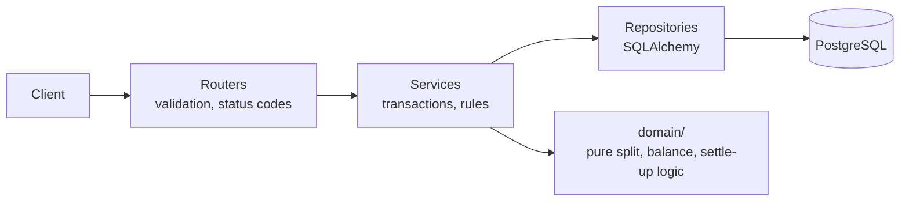

# Expense Sharing Service

A backend for groups to track shared expenses and see who owes whom. Built with FastAPI, SQLAlchemy and PostgreSQL. Money is stored as integer paise, every expense stores a snapshot of who shares it, and balances are derived from that history so they always add up to zero.

> Decentro SDE Intern assignment. Not production-grade by design; see "With more time".

## Quick start

```bash
git clone <repo-url> && cd expense-sharing
docker compose up --build          # API on http://localhost:8000, Postgres in a container
# docs: http://localhost:8000/docs
```

Without Docker:

```bash
python -m venv .venv && source .venv/bin/activate
pip install -r requirements.txt
export DATABASE_URL=sqlite:///./dev.db
alembic upgrade head
uvicorn app.main:app --reload
pytest -q
python scripts/seed_goa_trip.py    # creates Mohit, Rahul, Ankit and the Goa Trip example
```

## Architecture



```text
app/
  main.py            # app factory, error handlers, /health
  routers/           # users, groups, expenses, balances, settlements
  services/          # business rules, one transaction per write
  repositories/      # DB access
  domain/            # pure functions: split_equal, net_balances, pairwise, simplify
  models.py          # SQLAlchemy tables
  schemas.py         # Pydantic request/response models
alembic/             # migrations
tests/               # domain unit tests + API tests
scripts/seed_goa_trip.py
```

## Database design

| Table | Purpose | Key constraints |
|---|---|---|
| `users` | People | `name` not empty |
| `groups` | A trip or shared context | — |
| `group_members` | Who belongs to a group, and since when | PK `(group_id, user_id)` |
| `expenses` | One payment by one person | `amount_paise > 0`, `idempotency_key` unique, index `(group_id, created_at)` |
| `expense_shares` | How much each person owes for one expense | PK `(expense_id, user_id)`, `owed_paise >= 0`, Σ shares = amount |
| `settlements` | A recorded repayment between two members | `from_user <> to_user`, `amount_paise > 0` |

Why it looks like this:

- **Shares are stored, not recomputed.** An expense records who was in the group when it was added. Adding a member later does not rewrite old expenses, and unequal splits use the same table.
- **Integer paise.** No floating-point errors; every total is exact.
- **Balances are derived.** Net balance = paid − owed + settlements sent − settlements received. There is no balance table that could drift out of sync.

## API

Full interactive docs at `/docs`. Errors always use:
`{"error": {"code": "...", "message": "..."}}`

| Method | Path | Notes |
|---|---|---|
| POST | `/users` | `{"name": "Mohit"}` → 201 |
| GET | `/users` | |
| POST | `/groups` | `{"name": "Goa Trip"}` → 201 |
| POST | `/groups/{id}/members` | `{"user_id": 2}` → 201, 409 if already a member |
| GET | `/groups/{id}/members` | |
| POST | `/groups/{id}/expenses` | `{"paid_by": 1, "amount": "1200", "description": "Dinner"}`; optional `splits` for unequal; optional `Idempotency-Key` header |
| POST | `/expenses` | Same, with `group_id` in the body (matches the brief) |
| GET | `/groups/{id}/expenses` | `?limit=&cursor=` |
| GET | `/groups/{id}/balances` | Who owes whom + net per user |
| GET | `/balances` | All groups |
| GET | `/groups/{id}/settle-up` | Suggested minimal transfers (enhancement) |
| POST | `/groups/{id}/settlements` | Record "Rahul paid Mohit ₹400" |
| GET | `/health` | Checks the DB; 503 if unreachable |

Example: after Mohit pays ₹1200 for dinner in a 3-person group, `GET /groups/1/balances` returns:

```json
{
  "balances": {"Rahul": {"owes": {"Mohit": "400.00"}}, "Ankit": {"owes": {"Mohit": "400.00"}}},
  "net": [{"user_id": 1, "name": "Mohit", "net": "800.00"},
          {"user_id": 2, "name": "Rahul", "net": "-400.00"},
          {"user_id": 3, "name": "Ankit", "net": "-400.00"}]
}
```

## Assumptions

1. INR only; amounts accepted with at most 2 decimals and stored as paise.
2. An equal split covers members of the group at the moment the expense is created.
3. Members added later share only later expenses.
4. Removing members is not supported.
5. Rounding: leftover paise go one each to members in ascending user id, so ₹1000 / 3 = 333.34, 333.33, 333.33.
6. The payer must be a group member.
7. Duplicate names are allowed; ids are the identity. The name-keyed balance format is kept for compatibility with the brief.
8. Expenses are append-only; no edit or delete in this version.

## Design decisions

| Decision | Alternative | Why |
|---|---|---|
| `expense_shares` snapshot table | Split by current members at read time | History stays correct when membership changes; supports unequal splits |
| Integer paise | `DECIMAL` / float | Exact arithmetic, simple sums |
| Derive balances on read | Maintain a balances table | One source of truth; fast enough at this scale |
| Nested `POST /groups/{id}/expenses` | Only `POST /expenses` | Group comes from the URL, one less mismatch case; the flat route is kept as an alias |
| One transaction per write | Separate inserts | No half-written expenses |
| Idempotency-Key header | None | Safe client retries after timeouts |

## Product enhancement: settle-up

**Problem.** Balances say what people owe, not how to finish. Six people on a trip can end up with up to 15 pairwise debts.

**Feature.** `GET /groups/{id}/settle-up` returns the transfers that clear every balance, and `POST /groups/{id}/settlements` records a payment once it happens.

**Design.** A pure `simplify()` function takes net balances and repeatedly matches the largest creditor with the largest debtor. It needs at most n − 1 transfers. Suggestions are read-only; only recorded settlements change balances.

**Tradeoffs.**
- Greedy is not guaranteed to find the fewest transfers; the exact minimum is NP-hard. Greedy is predictable and good in practice.
- It can suggest a payment between two people who never shared an expense directly. That is why it is a suggestion, not automatic.
- Settlements are append-only; a mistake is corrected with a reversing entry.

## Testing

- `tests/test_domain.py`: rounding (₹1000/3, ₹0.01/3), exact-split validation, Σ net = 0 over random expenses, settle-up transfers clear all balances.
- `tests/test_api.py`: status codes, payer-not-member, member added later, idempotent replay, settlement updates balances, spec example reproduced exactly.

## Reliability notes

- Each write is one transaction, so a crash cannot leave shares without an expense.
- Retries with the same `Idempotency-Key` return the original response instead of creating a duplicate.
- If the database is down, requests fail fast with 503 and `/health` reports it.

## With more time

- Auth and per-user access to groups
- Edit/delete expenses as reversing entries with an audit trail
- A per-group balance table updated in the write transaction, for large groups
- Categories and monthly summaries; CSV export
- Multi-currency with stored exchange rates
- UPI payment link on each settle-up suggestion
