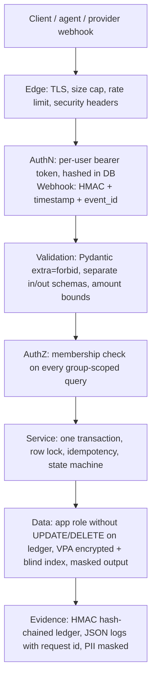

# SECURITY_AND_STACK.md — Expense Sharing Service

Trust is the product at a payments company, so security is designed in layers: every layer assumes the one in front of it can fail. Items marked **BUILD** ship in the assignment; **EXPLAIN** items are documented and discussed, not built.

## 1. Stack decision

| Layer | Choice | Why | Rejected (and why) |
|---|---|---|---|
| Language | Python 3.12 | JD + brief | — |
| Framework | **FastAPI** | Pydantic validation on money fields and OpenAPI docs (`/docs`) out of the box; the brief requires API docs | Flask: needs plugins for validation and docs (JD mentions it; logic layer is portable). Django+DRF: heavy for a small API |
| Database | **PostgreSQL 16** | Full ACID, `CHECK` constraints, `SELECT … FOR UPDATE`, roles/GRANT, Row-Level Security, JSONB | SQLite: one writer, no row locks. MySQL: no RLS; CHECK only enforced from 8.0.16. MongoDB: data is relational; transactions need a replica set and have tight lock timeouts |
| ORM | SQLAlchemy 2.0 | Explicit transactions, `with_for_update()`, raw SQL when needed | Django ORM (tied to Django) |
| Migrations | Alembic | Versioned, reviewable schema changes | `create_all()` |
| Validation | Pydantic v2, `extra="forbid"` | Rejects unknown fields; strict integer paise | marshmallow |
| Crypto | stdlib `hmac`/`hashlib`; `cryptography` (AES-GCM) | Audited libraries, constant-time compare | Custom crypto |
| Rate limiting | slowapi | Simple; swaps to Redis later (README notes it is still pre-1.0) | Hand-written middleware |
| Tests | pytest + httpx | API, rounding, concurrency and replay tests | unittest |
| Quality | ruff + mypy | Fast lint + types | flake8 + black |
| Runtime / CI | Docker Compose; GitHub Actions with a Postgres service | One-command run; tests on every push | Manual setup |

**When we would switch:** CockroachDB/YugabyteDB for multi-region writes; TigerBeetle (a purpose-built financial transactions database meant to run alongside SQL) as the balance engine if per-account write contention outgrows Postgres row locks.

**Interview line, "why not Flask?":** "The brief needs API docs and strict validation on money. FastAPI gives both from type hints, so my hours went into locking, idempotency and the ledger. The data layer is SQLAlchemy, so moving to Flask is mostly route wiring."

## 2. Security layers

## 3. Threats and controls (OWASP API Security Top 10, 2023)

| Threat | Example here | Control | Status |
|---|---|---|---|
| API1 Broken object-level authZ | Change `group_id`, read another group's balances | Caller must be a member of the group on every read/write; else 404 (not 403, to avoid confirming the group exists) | **BUILD** |
| API2 Broken authentication | Forged identity | Per-user random token (32 bytes) issued once at user creation; DB stores only its SHA-256 | **BUILD** |
| API3 Object property authZ | Client sends `status: "SUCCESS"` on a settlement | Separate input/output schemas; `extra="forbid"`; status only changes via the state machine | **BUILD** |
| API4 Resource consumption | Flood of requests, huge bodies | Rate limit per token and per IP → 429 + `Retry-After`; 64 KB body cap; pagination caps | **BUILD** |
| API5 Function-level authZ | User calls the provider webhook route | Webhook accepts only valid provider HMAC; never user tokens | **BUILD** |
| API6 Sensitive business flows | Scripted settlement spam | Tighter rate limit on settlement creation; one open settlement per pair | **BUILD** |
| API7 SSRF | — | Service never fetches user-supplied URLs | n/a (stated) |
| API8 Misconfiguration | Debug on, open CORS, stack traces | Debug off, CORS closed, global error handler, security headers | **BUILD** |
| API9 Inventory | Stale endpoints | `/docs` disabled outside dev; mock provider routes only in dev | **BUILD** |
| API10 Unsafe consumption | Trusting webhook payload | Verify signature, validate schema, forward-only state transitions | **BUILD** |

## 4. Protecting sensitive data ("an attacker learns nothing useful")

| Data | Treatment | Why |
|---|---|---|
| UPI VPA | **BUILD**: AES-256-GCM encrypted at app level (`vpa_ciphertext`, `key_id`), plus `vpa_blind_index = HMAC(k2, normalised_vpa)` for lookup; API returns only `ad***@okicici` | Disk encryption does not help once the DB is mounted or dumped; a DB dump alone reveals no VPAs |
| Phone (if added) | Same as VPA | Personal data |
| Amounts | Plaintext integer paise, protected by DB grants and the hash chain | Encrypting amounts breaks `SUM`, `CHECK` and balance queries; an amount alone identifies no one |
| User tokens | Only SHA-256 stored | A DB leak does not leak usable tokens |
| Logs | JSON logs; VPA/phone masked; tokens and signatures never logged; `request_id` on every line | Logs are a common leak path |
| Keys | From environment via a settings class, each with a `kid` so keys can rotate | EXPLAIN: secret manager + automated rotation; envelope encryption with a KMS |

**Agent-initiated payments (EXPLAIN):** an agent never sees a VPA or account. The server creates a payment intent (`pi_…`: payee token, amount, 10-minute expiry); the agent can only confirm that intent with an HMAC-signed, timestamped, nonce-bearing request; amounts above a limit need human approval.

## 5. Webhook integrity (mock provider) — BUILD

Header: `X-Provider-Signature: kid=k1,t=1730281000,v1=<hex>`
`v1 = HMAC_SHA256(secret[kid], f"{t}.{raw_body}")`

1. Read the **raw** body before parsing.
2. Reject if `|now − t| > 300 s` (replay window).
3. Compare with `hmac.compare_digest` (constant time).
4. Insert `event_id` into `provider_events` (UNIQUE). Duplicate → 200, no effect.
5. Apply only forward transitions: `PENDING → SUCCESS | FAILED`. Late or out-of-order events cannot move a settlement backwards.
6. **Fallback:** `GET /settlements/{id}/status` asks the provider when no callback arrives (mirrors Decentro's documented "Check Payment Status" alternative to its status callback).

## 6. Database hardening

| Control | Status |
|---|---|
| Parameterised queries only (SQLAlchemy); no string-built SQL | **BUILD** |
| Two roles: `owner` runs migrations; `app` has `SELECT, INSERT` on `ledger_entries`, `provider_events`, `expense_shares`, and no `UPDATE/DELETE` on them | **BUILD** |
| Constraints: `CHECK (amount_paise > 0)`, FKs, `UNIQUE (idempotency_key)`, `UNIQUE (event_id)` | **BUILD** |
| Row lock on the group row while writing a ledger entry, so two writers never take the same `prev_hash` | **BUILD** |
| Row-Level Security with `FORCE` (members see only their groups) | EXPLAIN |
| TLS `sslmode=verify-full`, SCRAM-SHA-256 auth | EXPLAIN (Compose network is local) |
| pgaudit for DB-level audit | EXPLAIN |

## 7. Tamper-evident ledger — BUILD

`entry_hash = HMAC_SHA256(audit_key[kid], prev_hash || canonical_json(entry))`, written in the same transaction as the entry while holding the group row lock. `GET /groups/{id}/audit/verify` recomputes the chain and returns `{"valid": false, "broken_at": <seq>}` on mismatch.

| Alternative | Why not (yet) |
|---|---|
| Plain audit table / DB triggers | Anyone with DB write access edits them silently |
| Plain SHA-256 chain | Someone with DB access can rewrite the entry **and** recompute every later hash |
| **HMAC chain (chosen)** | Key lives outside the DB, so a DB-only attacker cannot forge hashes |
| Digital signatures (Ed25519) | Third parties can verify without a secret; heavier key management → next step |
| Merkle tree | Efficient single-entry proofs at very large scale; not needed here |
| Blockchain | For trust across organisations; overkill inside one company |
| Anchor daily head hash externally | Detects tampering even if the HMAC key leaks → README "next" |

## 8. Availability and downtime

- `/health` checks DB connectivity; returns 503 when down so an orchestrator can restart or drain the instance.
- Pool and statement timeouts: requests fail fast with 503 instead of hanging; clients retry with the same idempotency key.
- Writes are single transactions: a crash never leaves half-written state.
- Additive migrations (new columns nullable first) allow deploys without downtime.
- Scale path (EXPLAIN): indexes → PgBouncer → read replicas for balance reads → materialised per-group balances → partition ledger by group + outbox worker with `SKIP LOCKED`.

## 9. Regulatory background (context only, no compliance claim)

RBI payment-data storage directive (2018): payment data stored in India. RBI card-on-file tokenisation (effective 1 Oct 2022). DPDP Act 2023: collect only what is needed for the purpose, apply reasonable safeguards, erase when the purpose ends. The design follows data minimisation; it does not claim compliance.

## Sources

- OWASP API Security Top 10 (2023): https://api-security.owasp.org/editions/2023/en/0x11-t10/
- Stripe webhooks (signatures, timestamp tolerance, rotation): https://docs.stripe.com/webhooks
- Razorpay webhook validation: https://razorpay.com/docs/webhooks/validate-test
- Python `hmac.compare_digest`: https://docs.python.org/3/library/hmac.html
- PostgreSQL encryption options: https://www.postgresql.org/docs/current/encryption-options.html
- PostgreSQL privileges: https://www.postgresql.org/docs/current/ddl-priv.html
- PostgreSQL Row-Level Security: https://www.postgresql.org/docs/current/ddl-rowsecurity.html
- PostgreSQL password auth (SCRAM): https://www.postgresql.org/docs/current/auth-password.html
- PostgreSQL SSL modes: https://www.postgresql.org/docs/current/libpq-ssl.html
- PostgreSQL explicit locking: https://postgresql.org/docs/14/explicit-locking.html
- OWASP Cryptographic Storage: https://cheatsheetseries.owasp.org/cheatsheets/Cryptographic_Storage_Cheat_Sheet.html
- OWASP REST Security: https://cheatsheetseries.owasp.org/cheatsheets/REST_Security_Cheat_Sheet.html
- OWASP Logging: https://cheatsheetseries.owasp.org/cheatsheets/Logging_Cheat_Sheet.html
- OWASP Secrets Management: https://cheatsheetseries.owasp.org/cheatsheets/Secrets_Management_Cheat_Sheet.html
- AWS KMS envelope encryption: https://docs.aws.amazon.com/kms/latest/developerguide/kms-cryptography.html
- PCI tokenization guidelines: https://listings.pcisecuritystandards.org/documents/Tokenization_Guidelines_Info_Supplement.pdf
- Blind index: https://github.com/ankane/blind_index
- Pydantic config (`extra="forbid"`): https://pydantic.dev/docs/validation/latest/api/pydantic/config/
- RFC 6585 (429): https://datatracker.ietf.org/doc/html/rfc6585
- MongoDB transactions in production: https://www.mongodb.com/docs/manual/core/transactions-production-consideration/
- MySQL 8.0.16 CHECK constraints: https://dev.mysql.com/blog-archive/mysql-8-0-16-introducing-check-constraint/
- SQLite locking: https://www2.sqlite.org/lockingv3.html
- FastAPI features: https://fastapi.tiangolo.com/features/
- TigerBeetle: https://tigerbeetle.com
- slowapi: https://github.com/laurentS/slowapi
- RBI payment data storage (2018): https://rbi.org.in/scripts/NotificationUser.aspx?Id=11244
- RBI tokenisation (2022): https://www.rbi.org.in/scripts/NotificationUser.aspx?Id=12363&Mode=0
- DPDP Act 2023: https://www.meity.gov.in/static/uploads/2024/06/2bf1f0e9f04e6fb4f8fef35e82c42aa5.pdf
